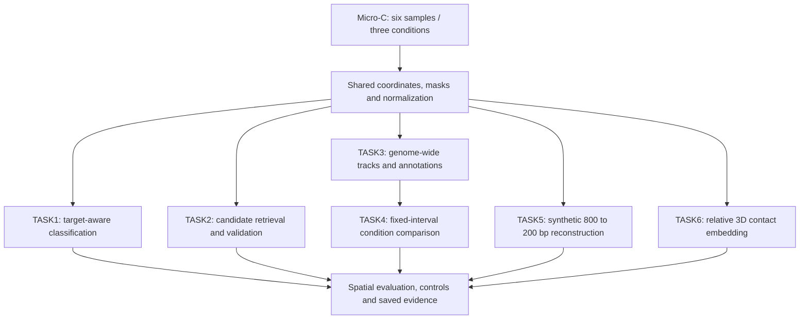
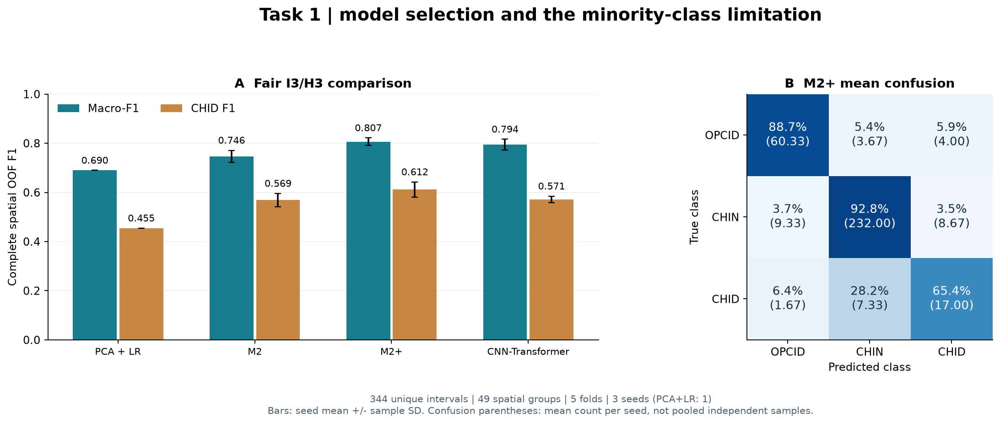
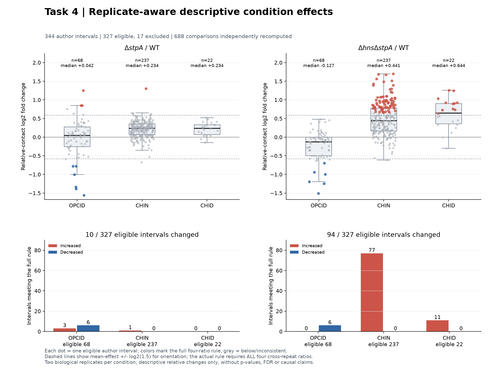

# MicroCTure

*Deep Learning for Micro-C Contact Matrix Analysis*

MicroCTure is a six-task research engineering project built on real *E. coli* Micro-C data. It connects target-aware structure classification, unannotated pattern retrieval, multi-condition genome visualization, contact-change analysis, synthetic super-resolution, and relative 3D embedding through shared coordinates, spatially controlled evaluation, and traceable results.

项目将真实接触矩阵、深度模型与传统基线、受控消融及可视化整合为完整分析链。每项任务保留正向结果、负结果和可复核的评价依据。

[六任务文档](docs/README.md) · [全基因组总览](submission/task3/atlas/v1/whole_genome.png) · [465页坐标索引](submission/task3/atlas/v1/pages.csv) · [结果来源索引](submission/results_delivery_manifest.json)

## Pipeline



任务二使用独立的候选检索流程；任务四固定作者已知区间，二者都不依赖任务一的预测标签。任务三提供任务四共享的信号和坐标基础。

## Six tasks · Key features

| Task | Objective | Methods | Key result | Details |
| --- | --- | --- | --- | --- |
| **TASK1** | Target-aware structure classification | PCA+LR、M2、M2+、CNN-Transformer；五空间折、三seed、输入与优化控制 | M2+ macro-F1 **0.8067±0.0153**；CHID F1 **0.6118±0.0308** | [分类、消融与错误分析](docs/TASK1.md) |
| **TASK2** | Unannotated pattern retrieval | AE/DAE、14评分配置、168次聚类、已知检索检查、重复和匹配背景 | **21个未注释候选**；未确认满足预设规则的新结构类型 | [候选级证据与NA](docs/TASK2.md) |
| **TASK3** | Genome-wide multi-condition visualization | 三条件六样本、100 bp轨道、Annotation QC、多尺度浏览 | **465张实际PNG及465个HTML页面**，共同有效bin **98.022276%** | [全景到局部图集](docs/TASK3.md) |
| **TASK4** | Condition-specific contact analysis | 344个作者区间、688次比较、四交叉比值、O/E敏感性 | ΔstpA **10条**、ΔhnsΔstpA **94条**满足描述性变化判据 | [条件效应与边界案例](docs/TASK4.md) |
| **TASK5** | Synthetic super-resolution | Bilinear、Bicubic、Plain/Residual CNN；逐窗口、距离和边界评价 | Residual CNN **34.33 dB**（WT rep1、三seed均值）；像素改善，边界偏移仍高于Bicubic | [像素与结构双评价](docs/TASK5.md) |
| **TASK6** | 3D contact embedding | MDS、Direct Geometry、Graph decoder；929节点、留出边评价 | Graph log距离RMSE **0.3073** vs MDS **0.4614**（WT rep1）；接触相关指标存在取舍 | [相对嵌入与反算核查](docs/TASK6.md) |

各任务指标服务于各自的评价目标，不构成跨任务排行榜。任务一的±为优化seed样本标准差；WT重复和优化seed不增加独立标注区间数量。完整结果以六份TASK文档和其链接的CSV/JSON为准。

## Selected results · Visual gallery

<details open>
<summary><strong>TASK1 · 统一模型比较与少数类混淆</strong></summary>



M2+是统一协议下的当前基准，CHID仍是主要短板。[输入消融、固定推理与全部结果](docs/TASK1.md)。

</details>

<details>
<summary><strong>TASK2 · 固定21候选的匹配背景与重复支持</strong></summary>


每候选20个匹配对照，20/21继续获得基线支持。原主形态校准最多8个对照，21例均保持not_evaluable；补充核查19例可评价、2例NA、0/19稳定异常。[候选、retrieval与形态核查](docs/TASK2.md)。

</details>

<details>
<summary><strong>TASK3 · 4.64 Mb全基因组、多条件与注释总览</strong></summary>


完整图集保留465张逐页核验的原PNG；新交互层使用固定RefSeq注释。作者结构端点约定仍独立标记provisional。[注释QC与预先固定局部区域](docs/TASK3.md)。

</details>

<details>
<summary><strong>TASK4 · 已知结构的条件相关接触变化</strong></summary>



327个区间通过质量规则；104条主判据变化的O/E效应方向全部一致，103条同时通过完整幅度判据，保留OPCID_55例外。[描述性规则和逐类型解释](docs/TASK4.md)。

</details>

<details>
<summary><strong>TASK5 · 像素改善与边界恢复的不同结论</strong></summary>


Residual在两个WT各53个测试窗口、每个seed的PSNR/SSIM均优于Bicubic；双WT汇总的边界代理偏移为211.01 vs 157.55 bp。[逐窗口配对与距离分层](docs/TASK5.md)。

</details>

<details>
<summary><strong>TASK6 · 留出距离拟合与接触一致性的取舍</strong></summary>


Graph改善留出对数距离RMSE，同时保留低于MDS的部分接触相关结果。[三维坐标与交互入口](docs/TASK6.md)。

</details>

GitHub可直接显示以上PNG。交互HTML需下载后运行本地服务；未配置GitHub Pages时，点击HTML文件会显示源码。TASK文档共引用20幅结果图，465页图集另作完整数字补充，没有复制成独立实验。

## Installation

在克隆后的`MicroCTure/`根目录执行，已有环境可跳过创建：

```bash
conda env create -f environment.yml
conda run --no-capture-output -n microcture python -B run.py --help
```

[environment.yml](environment.yml)定义Conda `microcture`，含Python、PyTorch及分析依赖；[environment.lock.yml](environment.lock.yml)记录版本。已有WSL环境经过验收，首次安装需要联网；其他平台的安装未逐一实测。

## Quick start · No raw data required

```bash
# 保存证据、链接与合成/数值测试；不启动科研训练
conda run --no-capture-output -n microcture python -B run.py check
# 使用随库M2+权重进行固定三例CPU推理，核对保存概率
conda run --no-capture-output -n microcture python -B run.py demo
# 查看交互结果；Ctrl+C停止
conda run --no-capture-output -n microcture python -B run.py serve
```

打开`http://localhost:8000/site/`；完整轨道图集为`http://localhost:8000/submission/task3/atlas/v1/`。演示按每类首个ID固定选例，并保留CHID_11误判；整体表现由完整OOF评价。

六任务参数入口如下，`--help`只显示用法：

```bash
conda run --no-capture-output -n microcture python -B run.py task1 --help
conda run --no-capture-output -n microcture python -B run.py task2 --help
conda run --no-capture-output -n microcture python -B run.py task34 --help
conda run --no-capture-output -n microcture python -B run.py task3-atlas --help
conda run --no-capture-output -n microcture python -B run.py task5 --help
conda run --no-capture-output -n microcture python -B run.py task6 --help
```

任务三/四共用`task34`完成六样本输入及固定区间比较；`task3-atlas`维护数字图集。完整训练、原始预处理和结果数组复算需要下面的数据与任务文档指定的输入，不能用展示文件代替。

## Dataset · Full experiments

数据来自[GEO GSE272159](https://www.ncbi.nlm.nih.gov/geo/query/acc.cgi?acc=GSE272159)，研究背景为Gavrilov等的[Elementary 3D organization of active and silenced E. coli genome](https://doi.org/10.1038/s41586-025-09396-y)。参考染色体为*E. coli* `NC_000913.3`，4,641,652 bp；WT、ΔstpA、ΔhnsΔstpA各两个生物学重复。

作者344个结构区间为OPCID 68、CHIN 250、CHID 26，来源可回查官方补充表；参考基因层使用NCBI RefSeq ASM584v2。原始Cooler、工作簿和大型缓存需自行取得，不随仓库分发。小型派生注释、固定划分和来源签名保留在`data/`。

[数据获取、文件名与缓存准备](data/README.md)说明原始文件位置、六样本下载配置和显式预处理入口。完整实验必须使用新的任务/实验/版本目录，不覆盖冻结结果。任务一有独立分类缓存，任务二至五使用接触带缓存，任务六使用5 kb缓存；具体依赖分别见TASK文档。

## Reproducibility

| 层级 | 可执行内容 | 前置条件 |
| --- | --- | --- |
| 直接浏览与核验 | 六任务文档、图表、候选表、图集、`run.py check` | 随库文件与环境；无需原始矩阵 |
| 真实推理示例 | `run.py demo`；15份M2+交叉验证权重 | 随库固定输入；CPU即可 |
| 保存结果复算 | OOF、候选判定、重建指标和三维指标 | 部分可由随库表复核；完整数组复算需本地`results/`及对应输入 |
| 完整计算 | 预处理、模型训练、全基因组分析 | 原始数据、任务缓存、配置及新的输出目录 |

```bash
# 只读核验六任务交付与已有来源哈希
conda run --no-capture-output -n microcture python -B run.py report-results verify
# 维护文档后刷新导航哈希，不重绘、不训练
conda run --no-capture-output -n microcture python -B run.py report-results refresh
# 仅完整本地工作区：核对三组冻结证据及只读权限
conda run --no-capture-output -n microcture python -B run.py verify-evidence --all
```

精简仓库不包含全部历史冻结实体；`verify-evidence --all`和`--require-local-inputs`检查需要额外本地证据。依赖这些文件的测试会明确跳过。任务二、五、六共18份历史checkpoint缺失，保存输出可复核，原模型直接推理未恢复；任务一随库15份M2+权重均可核验。

科学解释以各任务评价单位为边界：CHID仅26例，任务一outer与WT已被多轮开发查看；候选不等于确认新结构；任务四采用描述性规则；合成像素重建不等于真实超分辨率或边界恢复；相对三维嵌入不等于真实单细胞构象。项目未完成DINOv2对照。

## Repository layout

```text
MicroCTure/
├── run.py                         # 统一入口
├── microcture/tasks/              # 当前任务实现
├── microcture/history/task1/       # 原字节保留的冻结历史源码
├── scripts/task1/…task6/           # 任务入口；三四共享实现
├── scripts/shared/、project/       # 数据工具、核验与发布工具
├── configs/                       # 按任务/实验分区；layout.json解析旧路径
├── data/                          # 小型注释、元数据和固定划分
├── docs/TASK1.md … TASK6.md        # 每任务唯一维护说明
├── submission/                    # 精选证据、权重、固定演示与完整图集
├── showcase/、site/                # 结果快照和交互浏览
└── tests/                         # 合成数据、数值与完整性规则测试
```

原始数据、缓存、完整`results/`和作业报告本地留存，公开快照在`submission/`与`showcase/`。历史路径由[layout.json](configs/layout.json)映射，不重写冻结签名。源码沿用现有分区，任务四实现与任务三共享六样本分析，不额外复制代码。

## Citation / License

引用项目时使用[CITATION.cff](CITATION.cff)，使用数据与作者注释时同时引用原研究和GSE272159。项目代码沿用仓库已有的[MIT License](LICENSE)；MIT不替代第三方数据、注释或论文的许可。

任务二至六的基线来自[同仓库保存版本](https://github.com/PPEE523/MicroCTure/tree/3bbd4309dae0f2d2e4efe55f3398b575238975ba)及后续修复。数据来源、注释转换和第三方使用范围见[数据说明](data/README.md)。课程PDF和含个人信息的报告不纳入公开文件范围。
