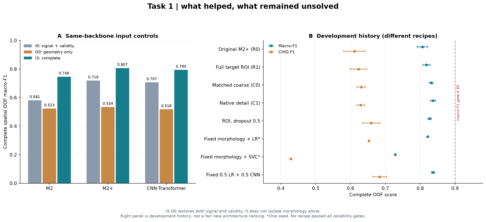
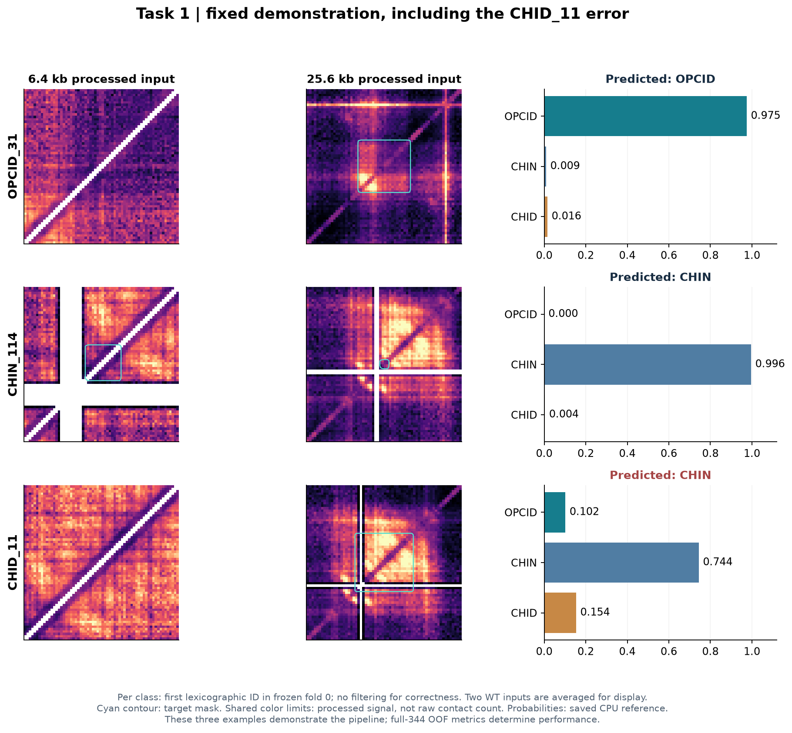

# 任务一：目标感知的已知结构区间分类

[返回项目概览](../README.md) · [任务目录](README.md) · [任务二：候选发现](TASK2.md)

**状态：统一模型比较、输入/优化控制和开发性改进已完成；可靠三类形态识别尚未达标。** 本文件是任务一持续维护的唯一说明，集中记录方法、实现、结果、图表、运行与剩余目标。更新：2026-10-15。

## 数据与评价协议

| 项目 | 固定规则 |
| --- | --- |
| 分类对象 | 344个唯一作者标注区间：OPCID 68、CHIN 250、CHID 26 |
| 数据视图 | 两WT重复是同一区间的两种测量，先平均概率再以唯一结构评分 |
| 空间隔离 | 49空间组、固定5个outer fold与原inner列表；同一区间和邻近相关数据不跨集合 |
| 随机性 | 神经模型seed42/43/44；PCA及几何LR为固定单seed |
| 输入 | 6.4/25.6 kb双尺度；信号、有效比例、目标区间比例及长度 |
| 拟合范围 | 距离期望、标准化和类别权重仅inner-train拟合 |
| 训练 | AdamW、加权交叉熵、batch32、H3、lr1e-4、dropout0.2、40轮末轮 |
| 统计 | 完整5折OOF形成一个seed结果；跨seed为样本SD，不是独立生物学置信区间 |
| 结论范围 | 坐标仍provisional；outer已被反复查看，属于开发性评价，不能重新称为盲测 |

### 问题定义与模型选择

输入一个给定区间及其两尺度接触上下文，预测OPCID、CHIN或CHID。这解决的是**给定候选区间的分类**，不包含自动确定全基因组结构边界。

旧M2的结果不足以支持三类识别，因此先排查输入与优化，再重新统一比较。保留四种主模型，是为了依次回答“简单表征是否足够”“原CNN能做到什么”“保留空间关系是否有效”“Attention是否提供增量”。

| 模型 | 设计 | 比较作用 |
| --- | --- | --- |
| PCA + Logistic Regression | 训练区拟合标准化→PCA16；长度绕过PCA后拼接；balanced LR、固定C=1 | 线性表征基线 |
| M2 | 6.4/25.6 kb双尺度共享CNN，全局平均池化 | 原CNN骨干在新协议下的基准 |
| M2+ | 双尺度CNN，保留4×4空间读出及前馈块 | 检验空间聚合是否限制分类 |
| CNN-Transformer | CNN空间token与Attention | 检验当前样本量和预算下的Attention收益 |

I3输入包含接触信号、有效像素比例、目标区间比例图和长度标量。目标比例图说明“本次要判断哪个区间”，不写入类别、结构ID或绝对坐标。它解决了同中心或重叠结构可能拥有相同裁窗、却对应不同目标标签的问题。

H3使用`LayerNorm → Linear → GELU → Dropout(0.2) → Linear`，全局学习率1e-4。在6个历史失败fold/seed开发案例中，H0/H1/H2/H3的持续学习通过数依次为 **1/6、2/6、3/6、6/6**。选择H3的依据是持续学习与避免常数输出的验收，没有用outer最高F1挑选分类头。

## 统一正式比较结果

统一5空间折、3个seed、I3/H3与40轮预算重新训练，完成 **155次拟合：135次神经训练和20次传统基线**。四主模型的完整I3比较占50次，其余105次用于输入消融与几何基线。

| 模型 | OOF macro-F1 | Accuracy | CHID precision | CHID recall | CHID F1 |
| --- | ---: | ---: | ---: | ---: | ---: |
| PCA + LR，单seed | 0.6897 | 0.8081 | 0.3750 | 0.5769 | 0.4545 |
| M2 | 0.7464±0.0249 | 0.8343 | 0.4449 | 0.8077 | 0.5691±0.0268 |
| **M2+** | **0.8067±0.0153** | **0.8992** | **0.5786** | **0.6538** | **0.6118±0.0308** |
| CNN-Transformer | 0.7941±0.0223 | 0.8915 | 0.5272 | 0.6410 | 0.5711±0.0136 |


**图1分析。** M2+相对M2的macro-F1提高6.02个百分点，相对Transformer提高1.26个百分点，因此保留为当前统一架构比较的基准。M2的CHID召回更高，但precision更低；只看召回会忽略误报。M2+的OPCID/CHIN/CHID F1分别为0.8670/0.9412/0.6118，少数类仍明显落后。

右图按每seed的真实类别归一，再取平均；括号是单seed的平均计数。M2+每seed平均有7.33个CHID被判为CHIN。三seed预测一致率为90.41%，但有20个区间在三seed中都预测错误，其中OPCID 3个、CHIN 11个、CHID 6个；**稳定预测包含稳定错误**。

## 输入消融与后续改进

| 输入 | 接触信号/有效性 | 目标掩码/长度 | M2+ macro-F1 | M2+ CHID F1 |
| --- | --- | --- | ---: | ---: |
| I0 | 保留 | 置零 | 0.7189 | 0.3751 |
| G0 | 置零 | 保留 | 0.5341 | 0.3344 |
| I3 | 保留 | 保留 | 0.8067 | 0.6118 |

I3优于G0，支持接触信号和有效性通道整体具有增量；几何单独也有预测能力，所以不能把全部收益归因于生物学形态。I3−I0同时增加掩码和长度，I3−G0同时恢复信号和有效性，两组比较都不能再细分成未单独控制过的因果贡献。



**图2分析。** 左侧是相同骨干、相同协议内的公平输入比较；三个骨干的完整输入均高于几何控制。右侧是后续开发历史，输入与配方不同，不能当作新的统一架构排行榜。扩大完整ROI、加入原生细节、固定形态摘要、固定融合或增加dropout，没有方案通过预登记可靠性门槛。固定0.5 LR＋0.5 CNN的开发性CHID F1最高，约0.6839，但三seed稳定错误增加到24个，未采用为已验证默认。

| 历史实验阶段 | 已执行规模 | 实际决定 |
| --- | ---: | --- |
| 输入I0–I3、几何基线、H0–H3控制 | 31次拟合 | 确立目标感知输入与持续学习配方 |
| 四模型正式比较及消融 | 155次拟合 | 统一架构比较保留M2+ |
| 目标加权读出 | 60次训练 | macro-F1及CHID F1下降，未采用 |
| 统一权重选择复评 | 155次拟合 | inner-CE选权重未优于固定末轮，未采用 |
| ROI、原生细节、形态摘要、dropout | 265次拟合，53份完整模型OOF | 未通过可靠性门槛；固定融合仅派生概率，不计新增训练 |

这些规模含协议重放和控制，不代表新增独立样本。自主阶段完整I3的75/75次神经拟合通过持续学习验收，全部225次神经outer没有常数概率或单类argmax；所有输入合计223/225次严格学习通过，两例控制损失回退被保留。

当前开发性门槛是：**每seed macro-F1≥0.90，且每类每seed precision与recall均≥0.85**，同时满足覆盖、持续学习与证据检查。没有方案通过；达到数值门槛也仍需专家形态真值和独立样本。CHID仅26个、分布于18空间组，是结论的主要限制之一。

## 固定演示与错误展示



**图3分析。** 示例按冻结fold0中每类字典序首个ID选取，没有按正确与否筛图。图中接触输入是两个WT的处理后信号均值；青色轮廓为目标比例图，白色为无效像素。目标覆盖整个窗口时没有内部轮廓。OPCID_31与CHIN_114预测正确，CHID_11被判为CHIN，概率约0.7442，这一错误如实保留。它展示模型输入和推理流程，不能用三个示例代替344例的OOF评价。

**任务一交付判定：模型比较、诊断、消融和推理示例已完成；可靠三类生物学形态识别尚未达成。**

证据：[本轮4472行OOF复算汇总](../submission/task1_delivery_summary.json)、[完整正式比较表](../submission/task1/formal/comparison.csv)、[开发阶段表](../submission/task1/autonomous/stage_scores.csv)、[可靠性判定](../submission/task1/autonomous/decision.json)。实现：[当前分类入口](../scripts/task1/run_task1_local.py)、[本轮复算绘图](../scripts/task1/visualization/build_task1_delivery.py)。

## 如何运行与验收

当前维护代码集中在`microcture/tasks/task1/`：数据加载和训练区变换在`data.py`，骨干与分类头在`models.py`，输入控制、诊断、受控拟合及消融矩阵统一在[ablation.py](../microcture/tasks/task1/ablation.py)，传统基线、统一模型比较与续跑在[comparison.py](../microcture/tasks/task1/comparison.py)。其余`protocol.py`、`training.py`、`evaluation.py`和`prediction.py`分别维护协议、通用训练、评价与推理。旧冻结源码仅在`history/`中归档。

完整结果按实验分区：模型比较在`results/task1/model_comparison/`，消融在`results/task1/ablation/`，对应审计在`reports/task1/`的同名分区。旧正式155次拟合属于同一联合协议，其内部I0/G0/I3仍保持完整，不能将同一份权重或OOF复制成多次新实验。

先按[项目README](../README.md)配置Conda `microcture`、准备数据。以下生产预处理和训练命令为操作入口，本轮文档整理没有执行它们；已有冻结结果不得覆盖。

不带原始数据的协议检查：

```bash
conda run --no-capture-output -n microcture python -B run.py task1 check
```

它检查随包结构/空间折/参数及模型，缓存缺失显示 `cache_status=not_prepared`，不伪装训练就绪。当前本机已准备缓存可只读检查：

```bash
conda run --no-capture-output -n microcture python -B run.py task1 \
  --cache data/task1/cache/target_aware_v1 check
```

从原始WT矩阵重建新缓存（不会训练）：

```bash
conda run --no-capture-output -n microcture python -B scripts/task1/prepare_task1.py \
  --data-root . --cache data/task1/cache/next_v1
```

`--data-config` 可指定另一JSON中的矩阵/工作簿路径，`--annotations` 可指结构CSV；必须保持冻结结构身份与空间划分，不能悄悄替换标签。距离期望、信号与长度变换只拟合inner-train，新的五折变换进入 `CACHE/formal/folds/`，训练/check自动识别。原冻结参考表只读。

```bash
# 四模型I3主比较：45神经+5 PCA，共50次拟合
conda run --no-capture-output -n microcture python -B run.py task1 \
  --run-dir results/task1/model_comparison/next_v1 --device auto main

# 或单独一个骨干，仍须完整5折×3seed（PCA只有一个固定seed）
conda run --no-capture-output -n microcture python -B run.py task1 \
  --run-dir results/task1/model_comparison/next_v1 --device auto main --model m2plus
# --model也接受m2、cnn_transformer、pca_lr

# 完整I0/G0/I3及几何LR，共155次；已验签完成项跳过，不重训
conda run --no-capture-output -n microcture python -B run.py task1 \
  --run-dir results/task1/model_comparison/next_v1 --device auto all

conda run --no-capture-output -n microcture python -B run.py task1 \
  --run-dir results/task1/model_comparison/next_v1 summarize
```

全局参数如 `--cache`、`--run-dir`、`--device` 放在main/all等子命令前；子命令后可指定 `--model`、`--fold`、`--seed`，局部运行不是完整模型评价。原始本机缓存复用时增加 `--cache data/task1/cache/target_aware_v1`，必要时 `--source-root .`；默认结果路径是交付版的新目录。

统一配方为I3/H3/lr1e-4、40轮末轮、五折/三seed、训练区拟合，不以outer挑权重。成功判据是预定任务覆盖、完整OOF每结构恰一次、无未解释invalid/failure、保存逐轮CE/头部/梯度诊断；识别是否可靠另按完整标准，不能仅看程序退出0。

历史同WSL/GPU的每神经fit约10–13秒，50主比较大致需数分钟至十余分钟（另有加载/预处理/CPU基线），完整155更多；CPU训练未重新计时。建议GPU可用显存8GB、batch32、4个CPU线程，CPU/缓存内存另预留数GB。这是历史依据，不是新入口已重跑训练的耗时。

候选区间推理入口 `scripts/task1/predict_task1_final.py --help`。随包15权重分别属于不同空间fold/seed；不要把它们当在全部数据上重训的新单模型。新候选需要匹配checkpoint的fold协议、已有count cache及区间CSV；给定区间预测不含自动候选发现。

### 本任务只读复算与演示

```bash
# 只读复算13份I3 OOF并重绘任务一的3张交付图；不训练
conda run --no-capture-output -n microcture python -B scripts/task1/visualization/build_task1_delivery.py
# 使用固定fold0/seed42权重，实际CPU推理并核对三例概率
conda run --no-capture-output -n microcture python -B run.py demo
# 仅完整本地冻结实体可用时：核对自主阶段原位只读封存
conda run --no-capture-output -n microcture python -B run.py verify-evidence --all
```

图表复算输出为`submission/task1_delivery_summary.json`及`submission/figures/task1_delivery_*.png`，数秒级CPU计算。单独重绘后，按README的交付检查说明刷新索引；不将推理示例或重绘计作新实验。

| 可复用交付 | 位置与含义 |
| --- | --- |
| 当前源码与配置 | `microcture/tasks/task1/*.py`、`scripts/task1/run_task1_local.py`、`configs/task1/current/task1_local.json` |
| 主比较与消融 | `submission/task1/formal/comparison.csv`，13组输入/模型设置的汇总；原正式实验共31份模型/seed OOF |
| 随包完整I3 OOF | `submission/task1/formal/oof/I3/`，13份、各344结构 |
| M2+权重 | `submission/artifacts/task1/m2plus/`，5折×3seed共15份，均为交叉验证成员 |
| 固定输入与CPU基准 | `submission/demo/task1/`，按每类首个ID选择，保留CHID_11错误 |
| 历史完整实验 | `results/task1/`及`reports/task1/`内按实验分区；封存目录只读 |

## 形态标准与下一步

作者的CHID涉及CHIN的域及群体平均接触组织，不能自行把“单个局部图必须同时有多个完整发卡”定义成标签真值。现有模型及AI图板核查不替代专家盲审，也不能因为模型预测不同就修改作者标签。原论文定义、来源核验和未解决问题保留于[历史形态判据](../microcture/history/task1/protocols/morphology_criteria.md)，该文件仅作历史依据，不再与本说明平行维护。

下一阶段首先需要可操作的专家形态标准、独立形态真值与未查看区域/样本。若改变默认输入、读出或权重规则，应预登记并让全部正式骨干在同一规则下重比。不能通过反复调已看outer、筛选正确案例或更换seed形成“形态可靠”结论。

原正式、读出、复评协议已收存至`report_materials/legacy_notes/`。当前操作以本文件和运行适配为准；[自主阶段预登记协议](../microcture/history/task1/protocols/autonomous_v1.md)保留原字节并通过布局映射核验；任务一后续进展统一维护本文件。
