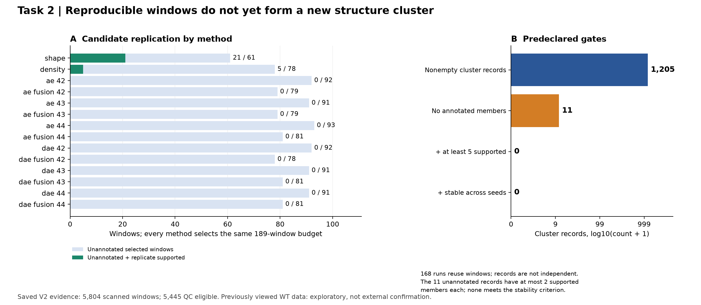
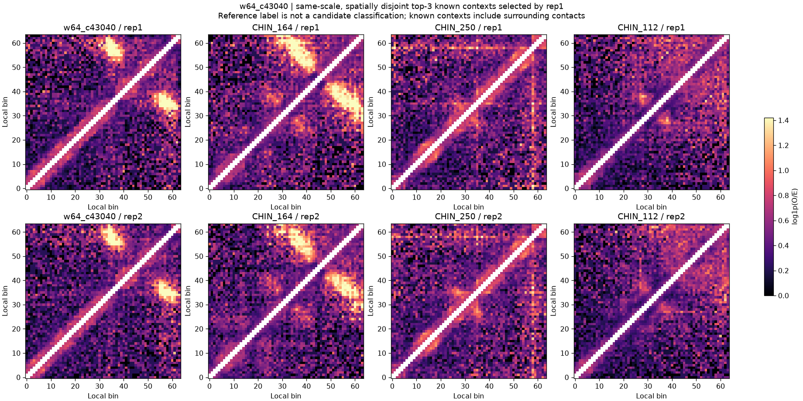
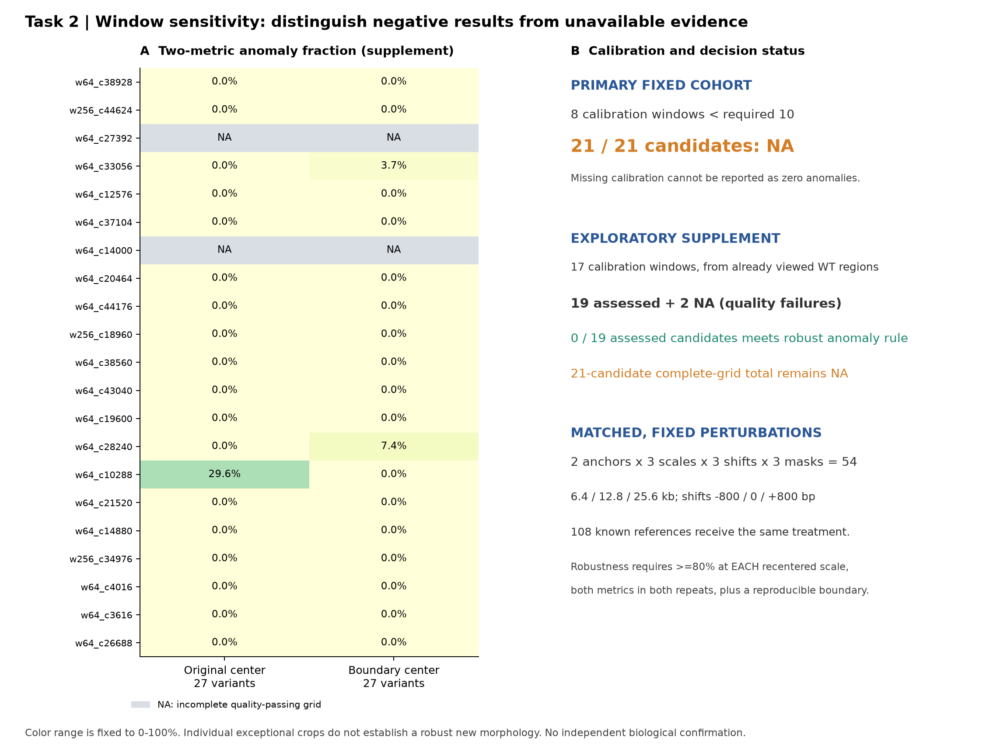
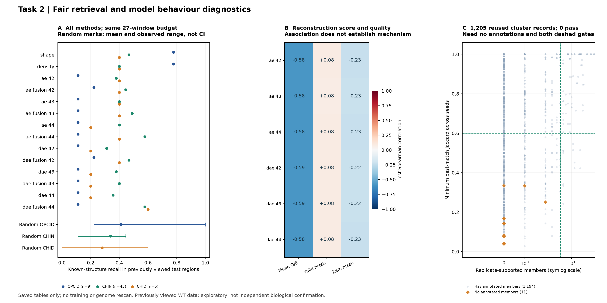
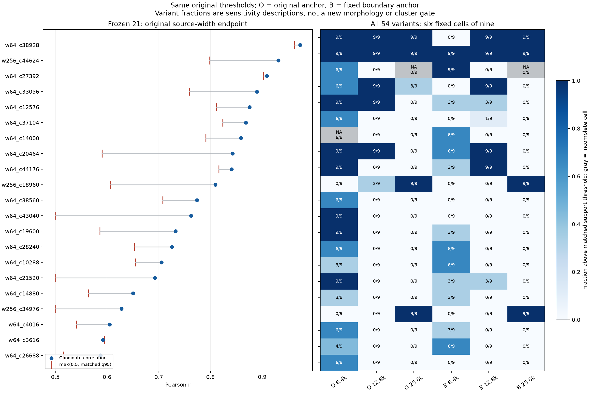
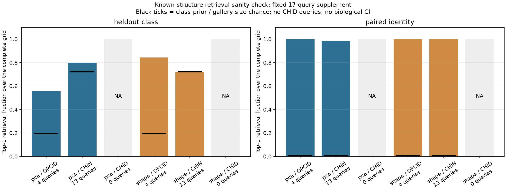
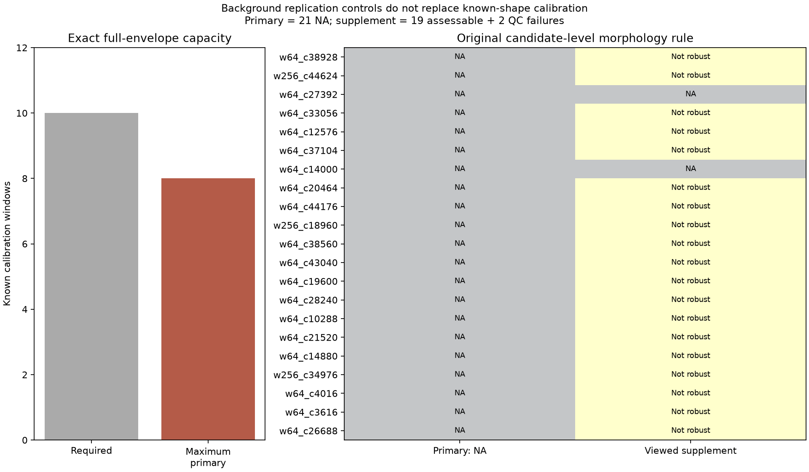

# 任务二：新结构候选发现与形态核查

[返回项目概览](../README.md) · [任务一](TASK1.md) · [任务三](TASK3.md)

**当前结论（2026-10-16）：原21个候选已固定并完成新对照重核，每例及每变体均有20个有效对照；原尺度基线20/21继续获得重复支持，1例低于阈值但仍保留。** 已将54变体汇总到候选级，并实际执行已知结构retrieval sanity check。尚未确认新结构簇；原主形态校准的最大空间容量确为8，低于10，21例形态端点仍为NA。

本文件是任务二唯一持续维护的任务说明。数据及共享环境见[项目概览](../README.md)和[数据说明](../data/README.md)。下文原两轮发现、形态和居中结果属于历史证据；2026-10-16的新验证读取现存100 bp缓存重算重复相关性，并读取保存表征完成已知检索，没有重新训练或扫描原始10 bp矩阵。新结果见[固定21候选证据页](../submission/task2/validation/frozen21_v1/index.html)。

## 问题定义与实现边界

输入是两份WT Micro-C矩阵，输出是值得进一步核查的局部候选及候选簇。任务回答“是否存在未注释、可复现、且有别于已知参考的模式”，并不以异常分数或聚类分离直接定义新生物学类型。任务二不依赖旧M2分类权重或分类输出，任务一的旧模型失败不要求废弃这部分已保存证据。

实现采用100 bp局部带状缓存，避免把原始10 bp全基因组矩阵展开成稠密图。训练、早停和内部评价按200 kb空间块分离，跨块窗口不进入这些集合；全基因组检索仍记录跨块候选。AE/DAE的归一化仅用训练区拟合。由于WT已经被开发过程多次查看，这种内部空间划分不能重新称为外部确认。

| 方法/控制 | 作用与固定设置 |
| --- | --- |
| 形态评分与密度评分 | 数值基线，用于区分局部布局与信号丰度 |
| AE | 学习局部窗口的重建表征；seed42/43/44 |
| DAE | 在AE框架加入15%输入遮挡；相同三个seed |
| 融合评分 | 将各AE/DAE评分与形态排名等权融合，完整报告全部设置 |
| AE/DAE训练预算 | latent16、每次最多2,000训练窗、最多40轮、patience6、batch64、学习率0.001 |
| 固定候选预算 | 每方法189个：140个6.4 kb及49个25.6 kb窗口；防止扩大候选数制造收益 |
| 匹配对照与另一重复 | 同宽、质量匹配、空间不重叠，检验候选是否在另一WT复现 |
| 聚类比较 | K=4/6/8/12 × seed42/43/44；保留所有方法和失败结果 |

主设置预先固定为`dae_fusion_42 / K=6 / cluster_seed42`，不是按得到新簇数量挑选。完整配置见[discovery_v2.json](../configs/task2/discovery/discovery_v2.json)；核心实现见[发现入口](../scripts/task2/discover_task2_v2.py)、[训练与空间规则](../scripts/task2/discovery_v2_core.py)、[原扫描入口](../scripts/task2/discover_task2.py)。

## 实验设计与新簇判据

在100 bp分辨率下，用6.4/25.6 kb窗口扫描，记录5,804个窗口，其中5,445个通过质量筛选。比较数值形态评分、密度评分、AE、DAE及融合，共14个设置；每设置固定189个候选。AE和DAE分别使用42/43/44三个训练seed，避免以扩大候选预算制造优势。

“新结构簇”需要同时满足以下操作性规则：

1. **窗口可重复：** 两WT相关性大于`max(0.5, 匹配对照相关性的95%分位数)`，至少有10个有效匹配对照。
2. **簇成员有支持且未注释：** 没有已标注成员，至少5个成员获得重复支持。
3. **聚类稳定：** 与其他聚类seed的最佳匹配成员集合，最小Jaccard≥0.6。固定比较`K=4/6/8/12`与三个seed，不以得到新簇的数量选择结果。

这些规则用于筛选值得验证的候选簇。即使通过，也还需要与已知类型的形态差异及独立生物学证据，不能仅凭“未注释”定义新类型。

| 检索与聚类结果 | 数量 |
| --- | ---: |
| 固定预算方法设置 | 14 |
| 聚类运行 | 168 |
| 非空簇记录 | 1,205 |
| 完全未标注的簇记录 | 11 |
| 上述11条记录中最多的重复支持成员 | 2 |
| 完全未标注且至少5个重复支持成员的簇记录 | 0 |
| 通过全部新簇规则 | **0** |
| 未注释且重复支持的候选并集 | 24 |
| 去除空间重叠后保留的候选 | **21** |

1,205是跨方法、K和seed的簇记录数，成员存在复用，不能理解为1,205次独立发现。



**图1分析。** 形态评分得到21个未注释且重复支持的窗口，密度评分得到5个；纯AE、DAE及所列融合设置在这个端点上均为0。形态评分更能保留重复出现的局部模式，但这些模式没有组成通过规则的新簇：完全未注释的簇支持成员最多仅2个，且稳定性也不足。因此，现有结果不足不能简单归因于换一个聚类标签就能解决。

## 是否存在与已知结构不同的形态

对21个候选与463条同尺度已知参考记录比较，这些记录对应266个结构ID，同一结构可在不同尺度复用，不能视作463个独立结构。PCA距离有2个候选在两WT中超过参考阈值，数值形态距离为0个；没有候选同时得到两项指标的一致支持。去除行列边际效应后的重复相关范围为0.101–0.789，提示部分信号依赖条带或行列强度，但不能据此直接判定为技术伪影。



**图2分析。** 第一列为候选，后三列为rep1固定选择的同尺度、空间不重叠参考，上下为两个WT，使用共同颜色范围。候选热点能在两WT重现，同时已知CHIN邻域也存在相似热点或条带布局。重复性支持信号存在，却不能单独证明类型独特；参考的作者标签也不等于对候选已经分类。

## 固定重新居中、多尺度与扰动核查

围绕可复现局部隔离位置，给未知候选和已知参考施加相同处理。每候选固定`2锚点×3尺度×3平移×3遮挡=54变体`：原中心/隔离边界中心；6.4/12.8/25.6 kb；−800/0/+800 bp；不遮挡及两组固定seed的10%遮挡。108个已知参考同样处理，分别校准PCA和数值形态距离。

稳健异常要求边界在两WT可复现、网格质量合格，并在重新居中的**每一种尺度**至少80%变体同时超过两项距离、两WT的阈值，避免只移动未知窗口直到远离参考。

| 判定端点 | 主固定方案 | 探索性补充方案 |
| --- | ---: | ---: |
| 校准窗口数 | **8，低于固定最低10** | 17，来自已查看区域 |
| 完整候选可评估 | 0/21 | 19/21 |
| 候选NA | 21/21 | 2/21，网格质量未通过 |
| 可评估子集中曾出现任意双指标异常 | NA | 3/19 |
| 可评估子集中重新居中后曾出现异常 | NA | 2/19 |
| 可评估子集中通过稳健异常规则 | NA | **0/19** |
| 全部21候选的完整汇总端点 | **NA** | **NA** |



**图3分析。** 灰色代表NA，不能当成零异常。补充方案中，`w64_c10288`原中心有8/27个异常变体，重新居中后为0/27；`w64_c33056`和`w64_c28240`重新居中后分别仅1/27和2/27。个别裁剪异常没有形成跨尺度、平移和遮挡都稳健的新形态。`w64_c27392`与`w64_c14000`质量失败，不能纳入阴性计数。

主方案必须报告“无法判定”；补充方案19例的零稳健异常只适用于该子集。补充数据已经被查看，不能将其称作新的外部确认。

**任务二交付判定：候选发现、对照和敏感性分析已完成；未发现满足规则的新结构簇，也没有确认新形态类型。**

证据：[结果汇总与来源哈希](../submission/task2_delivery_summary.json)、[方法比较](../showcase/results/task2_v2/method_summary.csv)、[21候选](../showcase/results/task2_v2/unannotated_supported_disjoint.csv)、[主方案](../submission/task2/centering/primary/report.json)、[补充方案](../submission/task2/centering/supplement/report.json)。实现：[发现入口](../scripts/task2/discover_task2_v2.py)、[结果复算绘图](../scripts/task2/build_task2_delivery.py)。

## 结果口径修复与可复现性

形态评分自身的21个未注释支持候选，与跨14方法去重后的21例不是完全相同的队列，两者只重叠19例；后续形态与居中核查采用跨方法去重队列，其中18个短窗口、3个长窗口。形态评分189例中共82例获得重复支持、21例未注释；跨方法去重的候选验证记录为972条，不能当作972个独立样本。

原居中判断曾把NaN阈值与数值比较的False误作零异常。当前实现[centering_status.py](../scripts/task2/centering_status.py)使用可空状态，校准不足、非有限阈值、质量失败或双重复证据缺失均报告`not_evaluable`。主方案21例的稳定异常数为`null`；补充组只对19个可评价候选报告0个稳健异常，完整21例汇总仍为NA。缺失不能被折算为阴性。

历史6份AE/DAE checkpoint目前缺失。已保存的评分、候选表、簇记录和距离表可复核，但不能声称已恢复历史权重或完成从checkpoint端到端重现；若需要重训，必须使用新版本目录和固定新协议。

## 全流程验收与模型行为诊断

新增[完整只读验收入口](../scripts/task2/review_task2.py)从冻结选择、逐窗口相关性和成员标签独立重算判据，而不是只检查汇总数字。验收实际通过：

| 核验对象 | 复算结果与解释 |
| --- | --- |
| 候选重复支持 | 972个唯一候选中117个通过；全部拥有20个有效匹配对照，阈值与支持逐条一致 |
| 控制窗口复用 | 19,440条匹配关系来自1,840个控制窗口，不能当成19,440个独立样本 |
| 簇成员与稳定性 | 168组聚类、1,205条非空簇逐条重算；11条完全未注释记录最多2个支持成员，最高Jaccard仅1/3 |
| 与已知混合的簇 | 108条记录有至少5个支持成员，666条达到稳定性0.6；这些均含已知成员，不能据此认定新簇 |
| 最终队列 | 24个跨方法未注释支持窗口，经固定相关性排序和环状空间去重得到21例 |
| 可复现性 | 保存表一致性通过；历史6份checkpoint仍缺失，未重放训练、残差评分或聚类中心拟合 |



**图4分析。** 左图在已查看测试区域、固定27窗口预算下比较全部14设置，并列出20次同预算随机参考的均值和观察范围。测试区含9个OPCID、45个CHIN、5个CHID；下表仅摘录固定seed42便于阅读，完整设置见图与[检索诊断CSV](../submission/task2/verification/v2/retrieval_diagnostics.csv)。

| 方法 | OPCID召回个数/9 | CHIN召回个数/45 | CHID召回个数/5 |
| --- | ---: | ---: | ---: |
| 形态评分 | 7 | 21 | 2 |
| 密度评分 | 7 | 18 | 2 |
| AE seed42 | 1 | 17 | 2 |
| DAE seed42 | 1 | 14 | 1 |
| 主方案 DAE融合 seed42 | 2 | 21 | 2 |
| 随机参考均值（最小–最大） | 3.70（2–9） | 15.25（5–20） | 1.40（0–3） |

中图保留相关系数的正负号：六个AE/DAE重建误差与测试区平均O/E的Spearman为−0.586至−0.580，提示评分与信号丰度有关。不能把这种相关解释为因果机制，也不能直接说异常评分已经学到独特形态。右图把重复支持数与Jaccard门槛同时画出，完全未注释记录全部位于两项门槛以下。

主居中校准的8个窗口为CHIN 6、OPCID 2；补充17个为CHIN 13、OPCID 4，两组均没有CHID。这是校准覆盖范围的限制，不修改既有判据，也不能把补充来源当作独立确认。

[逐候选交互证据页](../submission/task2/verification/v2/index.html)可检索21例的相关性、对照阈值、最近参考、两项距离判断和主/补充NA状态；[候选证据CSV](../submission/task2/verification/v2/candidate_evidence.csv)与[完整审查摘要](../submission/task2/verification/v2/review.json)保留可机读结果。完整972候选、1,205簇和14方法的重算明细在本地`reports/task2/verification/saved_v2/`，原实验文件没有修改。

当前训练入口还补齐了协议与产物保护：执行前验证空间分区、v1窗口网格及当前标注身份；重复支持缺失保持NA；两个WT保存对称的训练区拟合证据；每模型绑定输入、配置、分区、训练/验证索引和源码签名，缺件或错身份拒绝覆盖。新运行必须完整保存checkpoint、history和索引，最后才发布`COMPLETED.json`。顶层只支持新目录运行，不支持断点续训；这些是实现修复，没有产生新的实验分数。

## 冻结21候选的逐变体复验（2026-10-16）

本轮按用户要求固定原21个候选、原54变体、相关性下限0.5、分位数0.95、最少10对照，以及原形态稳健规则，不按新结果重新筛选候选。原候选CSV的SHA-256为`b92d11337486890934aa1077df5278f055ad349b973febbfc1873d45bd379a42`；[冻结文件](../submission/task2/validation/frozen21_v1/cohort_frozen.json)同时绑定输入、配置、源码、已知表征和缓存身份。

必须区分两个端点：**重复支持**使用未注释匹配背景的相关性分布，21例旧记录本已各有20个对照；**形态距离异常**使用已知结构校准到训练参考的距离分布，原主方案只有8个窗口。不能用普通背景相关性对照填入已知形态校准，也不能把相关性下限0.5套用到PCA欧氏距离。

### 对照冻结与不变的支持规则

新对照沿用原rep1近邻代价：`abs(log1p(mean_oe_control)−log1p(mean_oe_candidate)) + abs(valid_fraction_control−valid_fraction_candidate)`。没有新增根据结果选择的匹配容差。源窗口同宽、通过原0.8有效比例/0.8零比例规则、无作者注释；进一步按本轮全队列要求排除21候选的**完整扰动足迹**，对照的完整足迹位于同一空间分区，同一候选的各对照完整足迹互不相交。相比旧“只排除当前候选源窗”，空间排除更严格，结果属于新对照队列的开发性复核，不覆盖原记录。

只使用rep1匹配代价和全网格天然质量选择20个对照；ID先写入[对照冻结文件](../submission/task2/validation/frozen21_v1/controls_frozen.json)，之后才载入rep2。候选、对照均接受同一原中心/边界中心、尺度、平移和遮挡处理。未依据相关性高低或候选是否通过替换对照；没有重选最有利尺度或种子。

每变体按原式计算：`threshold=max(0.5, quantile(valid_control_correlations,0.95))`；有效对照少于10保持NA；候选分数必须**严格大于**阈值。自然质量失败也保持NA，不当成低于阈值。本轮420条匹配关系涉及316个不同对照，所有候选及变体均有20个有效对照，不将420条关系当作420份独立样本。



**图5分析。** 左图是每候选原宽度、原中心、零位移、无遮挡的支持端点；右图将54变体固定分成`2中心×3尺度`六格，每格9个平移/遮挡组合。蓝色为超过匹配阈值的比例；灰色格含不可评价变体，不能按完整阴性解释。六格是敏感性描述，**没有新增“54变体多数通过即可认定新形态”的规则**。

| 固定候选 | 基线r | 新阈值 | 基线支持 | 通过/可评价变体（共54） |
| --- | ---: | ---: | --- | ---: |
| w64_c38928 | 0.9736 | 0.9621 | 是 | 45/54 |
| w256_c44624 | 0.9314 | 0.7986 | 是 | 54/54 |
| w64_c27392 | 0.9090 | 0.9021 | 是 | 15/36，另18 NA |
| w64_c33056 | 0.8896 | 0.7588 | 是 | 27/54 |
| w64_c12576 | 0.8756 | 0.8118 | 是 | 24/54 |
| w64_c37104 | 0.8686 | 0.8239 | 是 | 7/54 |
| w64_c14000 | 0.8588 | 0.7907 | 是 | 12/51，另3 NA |
| w64_c20464 | 0.8426 | 0.5905 | 是 | 33/54 |
| w64_c44176 | 0.8406 | 0.8162 | 是 | 21/54 |
| w256_c18960 | 0.8095 | 0.6061 | 是 | 21/54 |
| w64_c38560 | 0.7736 | 0.7076 | 是 | 6/54 |
| w64_c43040 | 0.7626 | 0.5000 | 是 | 9/54 |
| w64_c19600 | 0.7324 | 0.5860 | 是 | 12/54 |
| w64_c28240 | 0.7253 | 0.6525 | 是 | 12/54 |
| w64_c10288 | 0.7053 | 0.6548 | 是 | 9/54 |
| w64_c21520 | 0.6927 | 0.5000 | 是 | 15/54 |
| w64_c14880 | 0.6502 | 0.5639 | 是 | 6/54 |
| w256_c34976 | 0.6279 | 0.5000 | 是 | 18/54 |
| w64_c4016 | 0.6049 | 0.5402 | 是 | 9/54 |
| w64_c3616 | 0.5923 | 0.5946 | 否，余量−0.0023 | 10/54 |
| w64_c26688 | 0.5874 | 0.5158 | 是 | 6/54 |

全部21例保留；没有因`w64_c3616`未通过而删除或重新选对照。它低于当前经验阈值，不等于已经证明信号不存在。`w256_c44624`在54变体中均有重复支持，也仍不能因此命名新类型；其他多数窗口的支持依赖尺度或中心。19例完整网格可评价，2例局部质量失败继续保留NA。

完整[候选级证据表](../submission/task2/validation/frozen21_v1/candidate_evidence.csv)包含基线分数、阈值、余量、有效对照数、六格支持数及主/补形态状态；[六格证据](../submission/task2/validation/frozen21_v1/candidate_scale_evidence.csv)另保留每格可评价分母、NA及最小/最大余量；[全部1134个候选—变体记录](../submission/task2/validation/frozen21_v1/candidate_variants.csv)可逐项追查。54变体不是54份独立生物学样本，不能据此缩小置信区间。

### 已知结构retrieval sanity check：实际执行结果

固定使用原主8个、补充17个已知校准查询，原训练参考108个（CHIN78、OPCID21、CHID9），不按检索好坏选例。相同54变体分别比较PCA与直接形态；共重算8100条排名记录。补充17例包含主8例，不作为两批独立样本累加；17例为OPCID4、CHIN13、CHID0。

**空间隔离的类别检索：** 已知查询分别在两个WT中检索同变体的固定训练参考，排除同ID及任何完整足迹重叠的参考；报告Top-1/Top-5，并列参考库类别比例及无放回随机Top-5先验。**跨WT位置检索：** rep2查询对rep1参考库检索，同ID为真实配对正例，其他重叠位置排除，单独衡量是否能找回同一已知位置。后者成功不等于三类形态泛化成功。



| 补充17个固定查询，全54变体汇总 | PCA | 直接形态 | 参照/限制 |
| --- | ---: | ---: | --- |
| 跨WT同位置Top-1 | 98.80% | 100.00% | 随机先验约0.80%；不是类别泛化 |
| 跨WT同位置Top-5 | 100.00% | 100.00% | 两WT是同一套位置 |
| OPCID同类Top-1 | 55.56% | 84.26% | 4个查询；类别先验19.44% |
| CHIN同类Top-1 | 79.77% | 71.87% | 13个查询；类别先验72.22% |
| CHID同类Top-1 | NA | NA | 无CHID查询，不能填0或声称通过 |

**图6分析。** 配对位置检索很强，说明保存表征能保留这些已知位置在两个WT中的相似性。类型检索较弱且依赖表征：直接形态的CHIN Top-1略低于其类别先验，两种表征的CHIN Top-5也未超过很高的先验。因此不能把“同位置找回率高”改写成“已知三类均可识别，所以未检出者必为新形态”。所有比例复用17个位置和扰动网格，不是独立生物学置信区间。

[逐已知查询的54变体汇总](../submission/task2/validation/frozen21_v1/known_query_evidence.csv)保留每查询及每中心/尺度的命中数；[分类别汇总](../submission/task2/validation/frozen21_v1/known_retrieval_summary.csv)保留先验和缺失类别；[全部排名记录](../submission/task2/validation/frozen21_v1/known_retrieval.csv)不筛除检索失败。此sanity check完成了数值核查，没有新增候选通过门槛或认证CHID覆盖。

### 原正式形态校准为什么仍补不到10

对主队列全部合格的21个已知窗口，固定原角色1、边界双WT可复现、全54变体质量合格、排除候选全足迹，再用**按结束位置排序的区间调度**计算最多可选多少互不重叠足迹。该算法在一维区间上给出最大基数，不是抽样运气；结果上限就是8，与原队列一致。



**图7分析。** 至少10个的原规则保持不变，当前数据在原限制下最多8个，所以主形态异常端点仍为21例NA；不能用本轮20个背景重复对照补足已知形态校准。探索补充的19可评价例仍无稳健异常，另外2例质量失败；完整21例形态汇总仍NA。图中“未达稳健异常”不是确认属于已知类别。

证据包括[全部合格形态校准位置](../submission/task2/validation/frozen21_v1/formal_calibration_pool.csv)及[最大空间容量与所选ID](../submission/task2/validation/frozen21_v1/formal_calibration_feasibility.json)。保持原空间规则而真正补足主形态校准，需要新增具有已知真值、且扰动足迹合格的校准位置；重复使用同一位置、把role2改称正式校准或换成普通背景均不能解决这一计数。

### 执行、核验与交付

本轮已实际运行`run.py validate-task2 run`：缓存与保存表征复核约19.55秒、进程峰值RSS约807 MiB，输出约5.2 MB；未训练、未扫描raw。建议复现预留至少2 GB内存，耗时受缓存解压与CPU影响。正式结果在`results/task2/validation/frozen21_v1/`；公开数值/图表快照在`submission/task2/validation/frozen21_v1/`，不覆盖两轮发现或主/补居中目录。

```bash
# 本机：复算1134项支持判定，并从保存表征重放8100条已知检索
conda run --no-capture-output -n microcture python -B run.py validate-task2 verify \
  --output-dir results/task2/validation/frozen21_v1
# 精简仓库：从公开相关性表复算阈值、126格及候选汇总，不重放表征
conda run --no-capture-output -n microcture python -B run.py publish-task2-validation verify
# 本机额外核对全部28个输入/源码/缓存哈希
conda run --no-capture-output -n microcture python -B run.py publish-task2-validation verify --require-local-inputs
```

新版本重核使用`validate-task2 preflight`后显式指定新的`results/task2/validation/<版本>`再执行`run`；入口拒绝覆盖已存在目录，输入或候选身份不符会停止。重核不以得到新簇为成功判据。产物保留候选/对照冻结、全部相关性、候选级与已知查询汇总、图表、`ARTIFACTS.json`和末写`COMPLETED.json`。

新增规则与便携验收测试覆盖严格阈值、9对照NA、匹配不读取结果、最大区间容量、缺失变体、检索去自身/重叠，以及即使重算哈希仍拒绝改阈值和把NA填0。新本机核验通过不等于新生物学确认；本轮没有产生新簇或正式新形态认证。

## 运行、资源与验收

以下命令均在克隆后的项目根目录执行，使用Conda `microcture`。原始数据不随仓库分发；六任务通用的安装、缓存构建和只读交付核验见[README](../README.md)。任务二使用两份WT的100 bp带缓存，默认复用`data/shared/cache/contact_bands_100bp/`；缓存缺失会明确失败，不静默扫描原始矩阵。

**只核验保存的居中判定：**

```bash
conda run --no-capture-output -n microcture python -B run.py review-task2 review \
  --data-root . --report-dir reports/task2/centering/review_next_v1
```

该命令只读保存表、重算NA状态并绘图，输出至指定的新`reports/`子目录。成功判据：主组21例未评估；补充19可评估、2不可评估；完整队列端点仍为NA。CPU轻量复核，不启动AE/DAE或全基因组扫描。

**完整保存结果与公开快照验收：**

```bash
# 重算发现、重复支持、聚类与去重判据；只向终端输出，不写目录
conda run --no-capture-output -n microcture python -B run.py audit-task2 check
# 不依赖本地原始矩阵，校验公开证据页、图、表及其SHA
conda run --no-capture-output -n microcture python -B run.py audit-task2 verify
# 本地历史小表完整时，额外要求全部来源文件存在且哈希一致
conda run --no-capture-output -n microcture python -B run.py audit-task2 verify --require-local-inputs
```

重新生成明细使用`audit-task2 review --report-dir reports/task2/verification/review_next_v1`。已有目录明确拒绝覆盖；`check`和`verify`均不训练、不扫描raw、不恢复缺失权重。

**重新扫描和训练（属于完整实验，运行前确认新版本输出路径）：**

```bash
# 元数据预检：已在本机通过；只查配置、344标注、5804窗口及带缓存头
conda run --no-capture-output -n microcture python -B run.py audit-task2 preflight \
  --output-dir results/task2/discovery/reproducible_v3
# 由用户执行完整新训练：直接复用已核验的v1窗口身份，避免额外重跑旧AE
conda run --no-capture-output -n microcture python -B run.py task2 \
  --data-root . --scan-file results/task2/discovery/v1/scan_rep1.csv \
  --output-dir results/task2/discovery/reproducible_v3
```

首次克隆不包含历史`scan_rep1.csv`。完整重跑需先通过`run.py task2-v1`在新目录生成v1窗口表（先查看`--help`），再将新表传入v2；不能把随库候选汇总当作全量窗口输入。`audit-task2 verify`核验随库快照，`audit-task2 check`及`review-task2 review`另需本地历史小表。

v2依赖v1的窗口身份。单独运行v2时可省略`--scan-file`读取本地保留的历史scan；如缓存另建，两个命令均增加`--band-cache-dir data/shared/cache/wt_next_v1`。输出路径已存在时，先改为新的版本名，不覆盖或删除历史结果。

预检不会创建训练目录，也不读取接触带像素；缓存内容与实际训练数值仍需正式运行检验。当前5804个输入张量约181 MiB，两份主带约95 MB；中间激活、PCA与库内存另计，建议至少2 GB可用内存。PyTorch使用4线程、六次AE/DAE各最多40轮；整套包含窗口处理、控制匹配和168组聚类，当前修复后未完整重跑计时，不能承诺分钟数。既有WT已查看，此轮若执行也属于开发性可复现重跑，不是新外部确认。

新运行验收除完整方法/簇/候选表外，必须有6份`*.pt`、6份history、6份`*_artifacts.json`、两重复的完整预处理、评分/表示NPZ、`frozen_before_rep2_reload.json`以及全输出`ARTIFACTS.json`和末写`COMPLETED.json`。失败或中断保留部分产物，用新的版本目录重新执行，不能只补一个丢失文件后宣称端到端重现。运行后回传新目录及`run_manifest.json`、`training_summary.csv`、`method_summary.csv`、`clusters.csv`、`report.json`、`ARTIFACTS.json`、`COMPLETED.json`和异常日志；全部六个seed/家族及不利结果都需保留。

| 执行项目 | 资源与耗时依据 | 输出与成功判据 |
| --- | --- | --- |
| 保存表复核 | CPU；仅小型CSV/JSON，不读raw像素 | 新复核目录、逐候选判定、NA状态与图一致 |
| v1扫描、v2训练聚类 | 主要使用CPU/4线程；含6次AE/DAE训练、14评分、168聚类；当前整合入口完整耗时未实测，不能承诺分钟数 | 新版目录中的`run_manifest`、训练轨迹、全部方法/聚类和候选验证表；不得只保留最好方法 |
| 缓存准备（缺失时） | 两WT主带约95 MB；构建还需float64累加、coverage、HDF5块，建议至少2 GB可用内存；约5.07亿原始非零记录使耗时依磁盘与CPU而异 | 两样本NPZ和完整manifest；构建命令与六样本扩展见README |
| 交付图表重绘 | `scripts/task2/build_task2_delivery.py`只读历史数值；当前环境数秒级、约1 GB可用内存足够，依首次启动而变 | 两张任务二新增图、`submission/task2_delivery_summary.json`；不生成新实验结论 |

完整实验应回传`run_manifest`、训练history、`method_summary.csv`、完整`clusters.csv`及候选验证表，并保留stdout/stderr中的错误。成功运行与成功发现是不同的验收：即使新簇仍为0，也应保留完整负结果。

## 后续工作与完成判定

| 项目 | 状态/下一步 | 验收边界 |
| --- | --- | --- |
| 候选检索、对照、重复与敏感性核查 | 已完成，可交付代码、数值和图表 | 21例未注释支持候选，不是21种新类型 |
| 满足规则的新结构簇 | 未获得 | 必须同时通过成员数、重复支持、聚类稳定性，不为增加新簇数量回调规则 |
| 新形态确认 | 未获得 | 预先固定未知与已知同等处理、足够独立校准、专家形态复核及未查看生物学样本 |
| 主方案NA | 保留不可判定状态 | 不能通过补充已看区域将其改称独立确认或全队列阴性 |
| 历史权重恢复 | 尚缺6份AE/DAE权重 | 需要新版本显式重训，不能把保存评分复算写成权重复现 |

后续更新仍写入本文件，证据落在独立版本目录；不另建“新版结论”MD并行维护。
