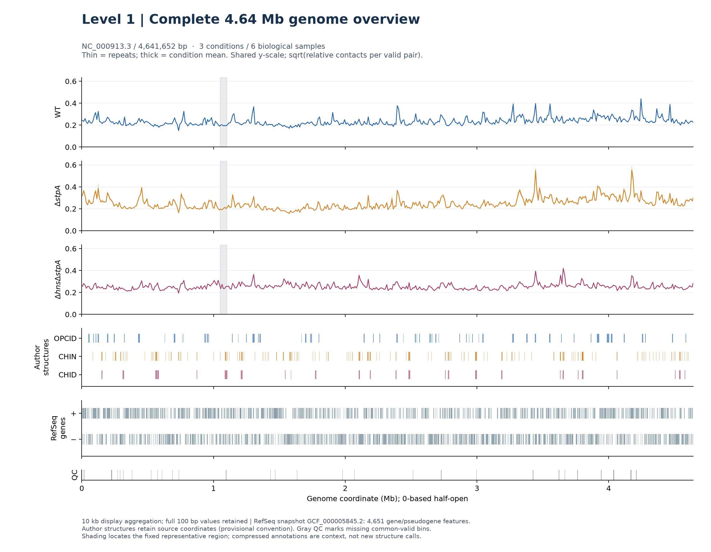
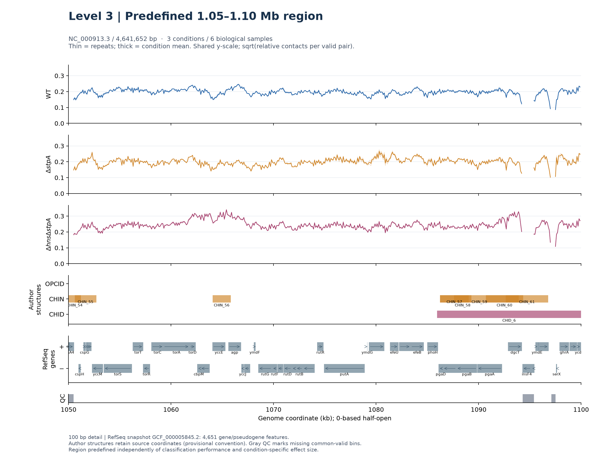

# 任务三：全基因组多条件轨道与注释展示

[返回项目概览](../README.md) · [任务二](TASK2.md) · [任务四](TASK4.md) · **[打开三级数字图集](../submission/task3/atlas/v1/index.html)**

**当前交付（2026-10-16）：完整465张轨道PNG、465个独立HTML页面、连续坐标索引，以及全基因组总览／固定代表区域已实际保存并核验。** 新默认浏览器和两张结果图使用独立的RefSeq基因层；原作者基因表及465张原图保留，注释差异逐行列出，没有把来源一致性等同于全部坐标认证。

**本页维护已核验的任务三结果、图表分析和三级数字图集；实验报告以这些保存结果为依据组织章节，写作与排版不改变实验设计、数值或解释边界。**

本文件是任务三唯一维护入口。任务三与[任务四](TASK4.md)共享六样本信号，分别回答“接触信号分布在哪里”和“固定作者区间怎样变化”；不依赖任务一分类器预测。本轮复用用户完成的`results/task3/condition_tracks/next_v1/`，不重训、不扫描raw、不批量重画465图，不修改原输入或已保存实验。

## 三级展示与实际交付

| 层级 | 作用 | 已保存内容 |
| --- | --- | --- |
| Level 1：Whole-genome overview | 一眼看到4.64 Mb全染色体接触分布 | 独立WT、ΔstpA、ΔhnsΔstpA轨；作者三类区间；RefSeq正负链基因；共同有效性条；10 kb显示聚合 |
| Level 2：465页完整浏览 | 从任意坐标定位与连续浏览，避免只展示精选页 | 465张PNG逐项验真、465个独立HTML页、上一页／下一页、坐标跳转、基因／别名／locus tag检索及完整索引；默认交互轨使用RefSeq |
| Level 3：预先固定代表区域 | 在100 bp细节上解释重复、注释和嵌套 | 1.05–1.10 Mb，三个条件共享y轴、双重复细线、条件均值粗线、结构区间及基因方向 |

下面两张图作为待审阅的正文候选图，本阶段先在本页展示与分析。465页作为完整数字补充，**Supplementary / digital repository: 465 genome-wide track pages.** 报告中的采用方式待审阅后确定。

### Level 1：完整染色体



**图1分析。** 六样本共用NC_000913.3的0–4,641,652 bp坐标。三个条件各有独立信号轴并共享y范围，细线为两个重复、粗线为条件均值；为全景可读性作10 kb显示聚合，原100 bp数值不变。作者OPCID／CHIN／CHID分别成轨，保留嵌套；基因轨来自固定NCBI RefSeq快照，末条表示共同缺失位置。阴影标出预先固定的代表区域。图支持定位整体信号与注释邻域，不提供结构分类、显著性或基因因果证据；全景压缩的基因轨应进入下一级查看。

### Level 2：完整数字浏览

[图集入口](../submission/task3/atlas/v1/index.html#browse) · [全部页面CSV](../submission/task3/atlas/v1/pages.csv) · [首页](../submission/task3/atlas/v1/pages/0000000_0010000.html) · [末页](../submission/task3/atlas/v1/pages/4640000_4641652.html)

已逐页核对465张实际PNG的格式、CRC、原运行SHA-256及坐标；页面无缺口、无重复，最后一页为4,640,000–4,641,652 bp。原PNG合计约68.34 MiB，全部数字页面随Git交付，无需把465张放进论文。

默认交互视图直接读取保存数值，展示经过坐标转换的独立RefSeq基因层；点击“查看保留的原始PNG”可追溯用户此次生成的原图。**原PNG使用作者补充表1的基因原坐标，并未重绘为RefSeq注释版本。** 原图可能按页缩放纵轴；默认交互图在当前区域的三个条件间共用y轴，跨页仍应读刻度，不能以曲线像素高度比较。

图集使用本地JavaScript数据文件，不依赖CDN，双击HTML也可浏览。推荐从项目根目录运行`conda run --no-capture-output -n microcture python -B run.py serve`，打开`http://localhost:8000/submission/task3/atlas/v1/`。

### Level 3：固定1.05–1.10 Mb



**图2分析。** 原100 bp轨道与RefSeq正负链基因、作者结构位于同一坐标。细线保留重复差异，粗线为条件均值；平方根仅用于显示，不参与任务四差异计算。结构重叠及嵌套保留，局部标注不意味着对应基因调控该接触结构。

> The representative region was predefined independently of classification performance and condition-specific effect size.

沿用既有1.05–1.10 Mb固定位置，不依据本轮条件差异、模型正确性或图像美观重新选位。该图用于解释读图方法，不能替代全量数字轨道或完整统计。

## 注释可靠性：来源、版本与坐标分别核验

### 来源与组装

1. 从[原研究](https://doi.org/10.1038/s41586-025-09396-y)的[官方补充表](https://media.springernature.com/original/springer-static/esm/art%3A10.1038%2Fs41586-025-09396-y/MediaObjects/41586_2025_9396_MOESM3_ESM.xlsx)重新下载核对，**与本地`标注数据.xlsx`字节完全一致**：SHA-256为`a1fa9c0d359509a9eb319442c19e300cb5da85546eeb567368a390d22205167a`。补充表1的4,516行及表4/5/6的344个结构逐条回查原行，无改标、删行或修订边界。
2. 独立取得[NCBI RefSeq ASM584v2 / GCF_000005845.2](https://www.ncbi.nlm.nih.gov/datasets/genome/GCF_000005845.2/)的GFF与组装说明，固定下载快照及SHA。组装说明确认`U00096.3 = NC_000913.3`、长度4,641,652 bp，与六份Cooler一致。
3. GFF采用1-based闭区间，**只转换一次为`[start−1, end)`**，正负链保持原值。保留gene与pseudogene两种特征，共4,651条（4,506 gene、145 pseudogene）；不将CDS、RNA子特征重复计为额外基因。

共享参考输入在`data/shared/annotations/reference/ASM584v2/`；公开固定快照、[规范基因CSV](../submission/task3/atlas/v1/reference_genes.csv)、[组装说明](../submission/task3/atlas/v1/assembly_report.txt)及[来源签名](../submission/task3/atlas/v1/sources.json)随数字图集交付。

### 作者基因表与RefSeq逐行比较

匹配同时使用基因名、locus tag、别名及方向，分别检查原数字按0-based半开和1-based闭区间解释是否精确一致。名称相同但区间不一致的行保留差异，不自动修正成参考坐标。

| 核查项目 | 实际数量 | 允许的解释 |
| --- | ---: | --- |
| 作者表基因行 | 4,516 | 含4,451个不同基因名称；行数不等于唯一基因数 |
| 与RefSeq精确一致，原表按1-based闭区间解释 | 4,296 | 这些行的端点及方向得到逐行支持 |
| 原表直接按0-based半开解释的精确匹配 | 0 | 不支持把原表原数字直接视为已认证半开坐标 |
| 名称／别名对应但坐标或方向不同 | 205 | 可能涉及版本、区间或历史分段差异，未自动改标 |
| 名称／别名未对应 | 15 | 保留原行，不猜测替代基因 |
| 作者结构回查原工作簿 | 344/344 | OPCID 68、CHIN 250、CHID 26；只认证来源和值一致 |

[4,516行完整比较](../submission/task3/atlas/v1/supplied_gene_audit.csv)与[344结构来源核验](../submission/task3/atlas/v1/author_structure_audit.csv)均可下载。4,296行的证据不能外推认证全部4,516行，更不能用基因表的坐标约定推断作者结构表的约定。

**交付口径：新视图使用有明确坐标规范的RefSeq参考基因层；作者结构保留原值与`provisional`端点约定；原465张PNG的作者基因层保留历史身份。** RefSeq是固定版本的参考注释，不是本批处理菌株逐基因实验确认；其与接触信号共定位也不构成因果证据。

## 数值方法与覆盖

| 项目 | 实际设置或结果 |
| --- | --- |
| 生物学样本 | WT、ΔstpA、ΔhnsΔstpA各两个重复，共六样本 |
| 原始与显示分辨率 | 原始10 bp；保存轨道100 bp；全景仅在显示时聚合10 kb |
| 局部接触范围 | bin距离2–100，即约200 bp–10 kb |
| 信号 | 接触计数／文库总计数×10⁶／有效接触对；相对而非绝对分子数 |
| 总bin／共同有效bin | 46,417／45,499，98.022276% |
| WT重复Pearson | 0.992492 |
| ΔstpA重复Pearson | 0.965737 |
| 双缺失重复Pearson | 0.992727 |
| 页面 | 连续465页，10 kb／页，末页1,652 bp |
| 新旧数值一致性 | signals、condition_means、common_valid、positions逐项一致，包括NaN |

共同无效位置保持缺失，不用0填补。全局相关支持摘要的重复性，不能替代局部形态认证；共同掩码可能排除某条件特异的接触丢失。环形染色体末端存在既有分箱近似，作者结构坐标也仍暂定。

## 实际执行、输出与验收

**用户完成的全图集运行：**`results/task3/condition_tracks/next_v1/`。496项输出与原`manifest.json`逐项匹配，其中465张轨道、20张任务四热图及其余数值／索引。此次数字整理未覆盖该目录，也没有重算任务四阈值或改变其结论。

**本轮已执行的轻量交付：**从保存NPZ／CSV核验、比对官方注释，生成两张新结果图、默认交互视图、465个HTML页及完整原PNG副本。没有训练、raw扫描或465图重绘。

- 公开产物：`submission/task3/atlas/v1/`，含`report.json`、`sources.json`、`ARTIFACTS.json`、末写`COMPLETED.json`。
- 本地核查：`reports/task3/atlas/v1/review.json`。
- 统一入口：`run.py task3-atlas`；实现：`microcture/tasks/task3/atlas.py`及`assets/`。
- 配置：`configs/task3/atlas/atlas_v1.json`，固定参考SHA、来源、原运行和代表区域。

```bash
# 在克隆后的 MicroCTure 项目根目录运行
# 便携只读验收：实际465图、完整HTML、参考转换与逐行注释判定
conda run --no-capture-output -n microcture python -B run.py task3-atlas verify
# 完整工作区另要求原输入、数值与源码哈希一致
conda run --no-capture-output -n microcture python -B run.py task3-atlas verify --require-local-inputs
# 仅本任务的科学规则测试，不训练、不批量重画
conda run --no-capture-output -n microcture python -B -m unittest tests.test_task3_atlas -v
# 刷新六任务导航与交付索引；不重绘其他任务
conda run --no-capture-output -n microcture python -B run.py report-results refresh
```

验收实际检查图像、哈希、页坐标与末端覆盖，重新解析GFF转换并重算逐行比较，不以465行CSV代替465张图。新增9项测试覆盖闭／半开转换、别名、方向、重复名称保留、缺图、坐标错页、额外图片及末页；另对交互脚本做首末页、全景、固定区域和同名基因查询的JavaScript运行检查，该检查使用DOM／canvas替身，不冒充真实浏览器截图验收。

生成入口拒绝覆盖既有版本。若将来更换参考或重新整理，修改配置中的**新版本输出路径**，重新固定输入与来源再执行`task3-atlas build --config <新配置>`。本轮仅两图及小表整理，CPU、建议约1 GB内存，耗时依磁盘复制与PNG核验而变；68.34 MiB原PNG是主要公开空间成本。完整六样本分析仍用`run.py task34 analyze`并交由用户在新目录执行，具体共享数值规则见[任务四](TASK4.md)。
