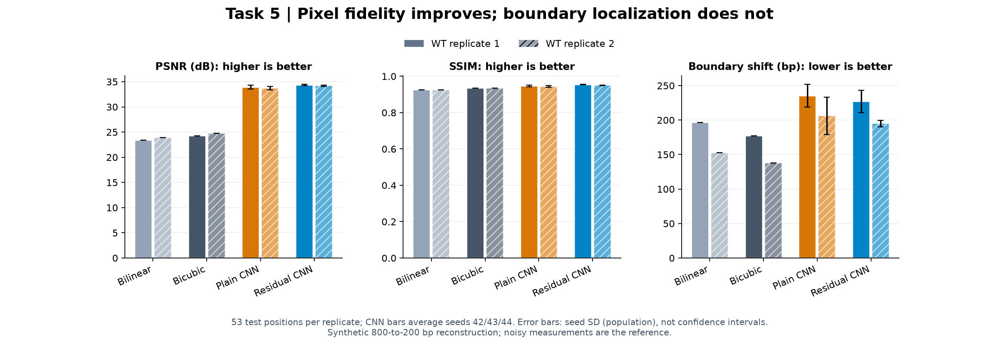
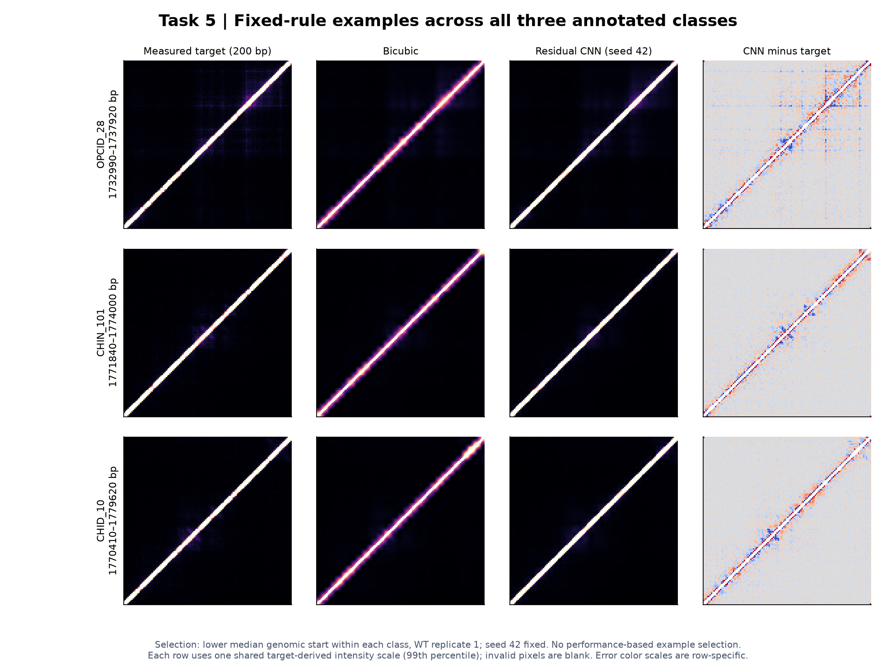
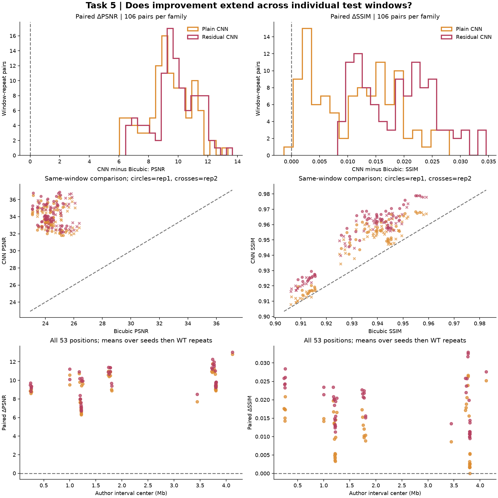
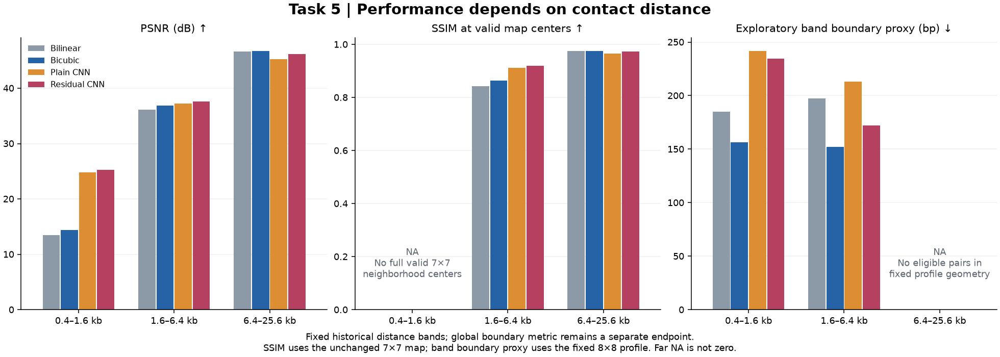
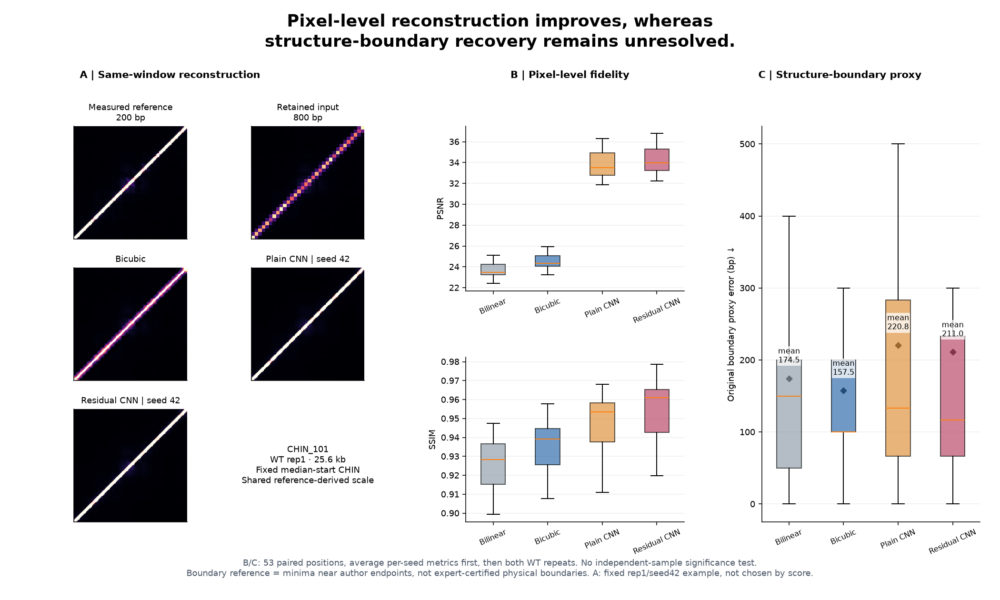

# 任务五：合成超分辨率与结构保持评价

[返回项目概览](../README.md) · 本文件统一维护任务五的问题、方法、结果、图表及运行说明。更新日期：2026-10-16。· [打开逐窗口与距离分层结果](../submission/task5/paired_analysis/v1/index.html)

**交付结论：四方法比较、六次CNN训练、保存预测及像素/结构双评价已完成。残差CNN改善当前800→200 bp合成任务的平均图像质量，但边界偏移没有改善；真实低深度到高深度的分辨率恢复尚未验证。** 本次整理使用历史实测结果及保存数组的复算，没有新增训练。六份历史CNN权重缺失，保存预测的可核验性与原模型的直接推理复现能力分别报告。

## 1. 问题定义与数据

输入由实测Micro-C矩阵合成聚合得到的800 bp低分辨率窗口，重建同一区域的200 bp参考矩阵。实验回答“已知退化规则下能否恢复像素与局部结构信号”，参考高分辨矩阵本身仍是带噪实测数据。

| 项目 | 实际设置 |
| --- | --- |
| 窗口 | 25.6 kb；100 bp带缓存中的256个bin |
| 目标与输入 | 聚合为128×128、200 bp目标，再构造32×32、800 bp输入；放大倍数4 |
| 空间划分 | 固定历史240训练、51验证、53测试位置；窗口间核对1,000 bp空间保护距离 |
| 重复分工 | 只用WT rep1训练、拟合预处理和选模；两份WT分别测试 |
| 测试构成 | OPCID 10、CHIN 39、CHID 4；53位置来自7个空间组 |
| 评价行数 | 8个方法/seed端点×53位置×2WT＝848行 |

同一位置的两WT及三个优化seed不能视为独立结构样本。任务五沿用的240/51/53位置划分与[任务一](TASK1.md)的49空间组、五折分类协议回答不同问题，不能互相替换。作者区间坐标约定仍为`provisional`。

预处理先在划分内部计算覆盖度，质量阈值由rep1训练区拟合；在有效掩码内聚合接触值并按文库深度归一化。`log1p`尺度及0.995分位数截断也只由rep1训练窗口拟合。输入包含接触通道与有效比例通道，避免将补零当作真实零接触。

## 2. 模型、对照与训练实现

| 方法 | 实现与作用 |
| --- | --- |
| Bilinear | 双线性插值，无训练参数；检验简单平滑放大的表现 |
| Bicubic | 双三次插值，无训练参数；作为更强插值与边界对照 |
| Plain CNN | 先双线性上采样，再经5×5、3×3、3×3卷积；隐藏通道16、ReLU；直接预测矩阵 |
| Residual CNN | 相同卷积规模，预测值与双线性接触通道相加；末层零初始化，从插值起点学习修正 |

两CNN均用seed42/43/44、Adam、学习率0.001、batch16、最多30轮、验证损失patience6；使用相同位置、掩码和预处理。损失为有效像素上的均方误差，并先按每个窗口的有效像素数归一，使窗口等权；输出对称化并在评价时截断到[0,1]。每个seed使用验证损失最佳权重，不以测试图或测试指标选轮次。

Plain与Residual末层初始化不同，因此二者的差值反映当前完整设置的比较，不能解释为只改变“残差开关”的严格因果消融。配置在[optional_tasks.json](../configs/shared/optional_tasks.json)，实现入口为[train_task5.py](../scripts/task5/train_task5.py)。

评价同时保留PSNR、SSIM、像素形状相关、结构剖面相关和边界偏移。图像评价使用有效上三角且排除最近对角项；SSIM还要求完整有效邻域。边界偏移是在作者区间端点附近，比较预测和参考局部剖面极小值的位置偏差，**不是专家标定的真实边界误差**。

## 3. 结果与图表分析

CNN数值为三个seed均值，插值方法不训练。↑越高越好，↓越低越好。

| 方法 | rep1 PSNR↑ | rep1 SSIM↑ | rep1边界偏移bp↓ | rep2 PSNR↑ | rep2 SSIM↑ | rep2边界偏移bp↓ |
| --- | ---: | ---: | ---: | ---: | ---: | ---: |
| Bilinear | 23.3823 | 0.9246 | 196.23 | 23.9337 | 0.9250 | 152.83 |
| Bicubic | 24.2375 | 0.9341 | **177.36** | 24.7795 | 0.9336 | **137.74** |
| Plain CNN | 33.9084 | 0.9469 | 235.22 | 33.7415 | 0.9436 | 206.29 |
| **Residual CNN** | **34.3324** | **0.9544** | 227.04 | **34.1928** | **0.9510** | 194.97 |



**图1分析。** 残差CNN在两个WT的平均像素指标上优于插值和普通CNN，但边界偏移均高于Bicubic。图中误差条为三个优化seed的总体标准差，`ddof=0`，不是生物学置信区间。

进一步按位置配对比较Residual CNN与Bicubic：先平均三个seed，再平均两个WT。53位置的PSNR与SSIM全部提高，平均分别为**+9.7541 dB、+0.01883**；边界偏移却平均**增加53.46 bp**，25位置变差、14改善、14不变。53位置只来自7个空间组，这些计数用于描述，不作独立样本显著性宣称。

像素重建与结构端点是不同目标。当前结果支持前者改善，不支持边界恢复成功；历史距离分层诊断中，远距离层的seed42 CNN PSNR也低于双三次，不能将整体均值改善外推到每一距离层。



**图2分析。** 固定rep1、seed42，在每类测试位置中按起点取下中位数，得到OPCID_28、CHIN_101、CHID_10，没有按重建指标选图。CNN较好恢复对角线及整体像素，差值图仍显示局部模式存在残差，与边界结果不改善相符。每行的目标、Bicubic和CNN三列共用由目标99%分位数确定的色标；差值列使用各行独立的对称误差色标，不能跨行按颜色比较误差绝对大小。

### 3.1 逐窗口 paired improvement：不是只比较总体均值

对同一测试位置、同一WT重复，先平均同一CNN家族三个seed的**指标**，再减去该窗口Bicubic指标：`ΔPSNR = mean_seed(PSNR_CNN) − PSNR_Bicubic`，SSIM与原边界代理误差同理。没有先平均预测图再计算指标，也没有以最好seed代替全部seed。每家族有106条窗口—重复配对；另将同位置双WT平均形成53条位置汇总。两家族合计的212/106行不代表新增独立位置。

| CNN | WT重复 | 平均ΔPSNR/dB | PSNR改善窗口 | 平均ΔSSIM | SSIM改善窗口 |
| --- | --- | ---: | ---: | ---: | ---: |
| Plain | rep1 | 9.670823 | 53/53 | 0.012834 | 53/53 |
| Plain | rep2 | 8.962040 | 53/53 | 0.010015 | 52/53 |
| Residual | rep1 | 10.094847 | 53/53 | 0.020258 | 53/53 |
| Residual | rep2 | 9.413273 | 53/53 | 0.017408 | 53/53 |

Residual的PSNR及SSIM在**每个WT的全部53窗口、每个seed**均超过Bicubic。因此，其整体像素收益不是少数高分窗口拉高均值。Plain的rep2在CHIN_212（作者区间3,796,820–3,808,240 bp）有一例平均ΔSSIM=−0.001299；跨WT平均会掩盖此例，故保留重复级结果。Plain在全部三个seed均提高SSIM的位置分别只有46/53、33/53，不能将家族均值改善写成每个seed普遍改善。



**图3分析。** 上排为106条配对的ΔPSNR/ΔSSIM分布，中排为同窗口Bicubic与CNN指标散点，虚线为相等线；下排保留全部53位置的坐标与双WT平均增益。它回答“改善是否普遍、在哪里”，不将相邻位置或重复当独立样本，也不将该53位置外推到整个基因组。

### 3.2 按结构类型和空间位置检查边界失败

下表均为Residual−Bicubic，先平均seed，再平均双WT。边界差为正表示偏移更大；边界“改善/持平/变差”的容差固定为1e−10。

| 作者类型 | 位置数 | 平均ΔPSNR/dB | 平均ΔSSIM | 平均边界差/bp | 边界改善/持平/变差 |
| --- | ---: | ---: | ---: | ---: | ---: |
| OPCID | 10 | 10.557402 | 0.020582 | 30.000 | 2/5/3 |
| CHIN | 39 | 9.537765 | 0.018300 | 41.880 | 12/8/19 |
| CHID | 4 | 9.854577 | 0.019655 | 225.000 | 0/1/3 |

三个类型的像素增益均为正；边界却没有相同的普遍改善。CHID仅4位置，不能据其较大均值作稳定类型排序。七个空间组的Residual平均ΔPSNR均为正，范围8.345435–13.048164 dB；其中最高组仅1位置，不能按组均值声称某基因组区域具有更强生物学效应。完整组别、位置和两WT结果均保留在可下载表中。

### 3.3 固定距离层：收益不覆盖所有contact尺度

沿用已有距离诊断的半开层：0.4–1.6、1.6–6.4、6.4–25.6 kb，扩展到全部八个方法/seed端点、两WT和53位置，共2,544行。下表先平均每seed指标，再对双WT和53位置等权平均；不把像素当独立窗口。原48条方法/重复/距离PSNR摘要全部复核一致。

| 距离层 | 方法 | PSNR/dB↑ | SSIM↑ | 探索性距离受限边界代理/bp↓ |
| --- | --- | ---: | ---: | ---: |
| 0.4–1.6 kb | Bilinear | 13.498725 | NA | 184.906 |
| 0.4–1.6 kb | Bicubic | 14.360750 | NA | 156.604 |
| 0.4–1.6 kb | Plain | 24.810791 | NA | 241.824 |
| 0.4–1.6 kb | Residual | 25.216309 | NA | 234.591 |
| 1.6–6.4 kb | Bilinear | 36.133216 | 0.841866 | 197.170 |
| 1.6–6.4 kb | Bicubic | 36.822971 | 0.864455 | 151.887 |
| 1.6–6.4 kb | Plain | 37.221676 | 0.912038 | 212.893 |
| 1.6–6.4 kb | Residual | 37.610009 | 0.919154 | 172.013 |
| 6.4–25.6 kb | Bilinear | 46.631855 | 0.974686 | NA |
| 6.4–25.6 kb | Bicubic | 46.741617 | 0.975606 | NA |
| 6.4–25.6 kb | Plain | 45.229947 | 0.965275 | NA |
| 6.4–25.6 kb | Residual | 46.174047 | 0.972867 | NA |

SSIM使用原7×7映射，按中心像素距离归类，仍要求整个邻域有效，不将层外像素抹零。近距离中心均无法容纳完整有效邻域，因此近层SSIM为**not evaluable**；不缩小SSIM窗口来制造分数，中/远层的邻域可跨距离层。

**距离受限边界代理是新增探索性诊断，不覆盖原边界指标。** 保留原8×8跨边界几何、±5 bin搜索及200 bp步长，只将剖面接触对限制到各距离层；有效对不少于该层几何可能对数的一半。原全剖面的分母是64，新诊断的分母为层内几何可能对数，二者不得混写。该几何最大距离为15×200=3,000 bp，因此中层边界实际使用1.6–3.0 kb接触，远层没有任何可用对而为NA，不能填0或复制全窗口边界误差。



**图4分析。** Residual相对Bicubic的PSNR增益在近/中/远层分别为+10.855559、+0.787038、−0.567570 dB。中层SSIM提高，远层PSNR和SSIM均下降；近层SSIM不可评价。可评价的近/中层边界代理仍高于Bicubic。这说明整体像素改善主要来自较近距离接触，不能外推为每一尺度有效，更不能作为边界恢复成功的证据。

### 3.4 最终三面板结论图



**图5分析。** A固定CHIN_101、WT rep1、seed42，展示同窗口的实测200 bp参考、800 bp输入、Bicubic、Plain和Residual；位置沿用CHIN测试起点下中位规则。800 bp输入从保存100 bp计数、原有效性及固定log尺度恢复，重新插值与已保存Bilinear/Bicubic的最大误差均为0，没有用截断后的目标反推假输入。B比较53位置的PSNR/SSIM分布；C比较**原始全剖面**边界误差，菱形是均值，不是距离受限代理。

双WT位置均值为：Bicubic **157.55 bp**、Bilinear **174.53 bp**、Residual **211.01 bp**、Plain **220.75 bp**。实际排序中Residual优于Plain，但两CNN都没有优于插值；不能为符合预期而把Residual画成最差。科学结论为：**Pixel-level reconstruction improves, whereas structure-boundary recovery remains unresolved.**

## 4. 完成状态、证据与限制

| 交付项 | 状态与依据 |
| --- | --- |
| 合成任务与公平比较 | 已完成四方法、六次CNN训练、八个端点评价 |
| 保存结果独立复算 | 已从全部保存重建矩阵复算848行、九项图像/结构指标，最大误差为0 |
| 像素质量改善 | 已观察到两WT平均改善及53位置配对改善 |
| 边界保持 | 未达改善目标，平均偏移较Bicubic恶化 |
| 历史模型直接推理 | 六份CNN权重缺失；可核验保存预测，不能声称已恢复原模型 |
| 真实分辨率恢复 | 未验证真实低深度→独立高深度、Hi-C→Micro-C或原始10 bp细节恢复 |

主要证据及复核入口：

- [可机读汇总、逐位置配对与来源](../submission/task56_delivery_summary.json)。
- [新增逐窗口配对CSV](../submission/task5/paired_analysis/v1/paired_windows.csv)、[双WT位置CSV](../submission/task5/paired_analysis/v1/paired_positions.csv)、[结构/空间组分层](../submission/task5/paired_analysis/v1/pair_summary.csv)、[距离摘要](../submission/task5/paired_analysis/v1/distance_summary.csv)、[新增来源与完整汇总](../submission/task5/paired_analysis/v1/summary.json)。完整seed与距离逐窗口表在`results/task5/paired_analysis/v1/`。
- [逐窗口历史指标](../showcase/results/task5/metrics.csv)、[历史汇总](../showcase/results/task5/summary.csv)、[距离分层诊断](../showcase/results/task5/distance_diagnostics.csv)、[结构剖面图](../showcase/results/task5/structure_profiles.png)。
- 完整本地复算记录：`reports/shared/tasks56/review_v2/review.json`、`task5_recomputed_metrics.csv`；公开的可机读复算结论见上方交付汇总。
- [保存结果复算实现](../scripts/shared/tasks56/review_saved_task56.py)、[本文件图表的生成实现](../scripts/shared/tasks56/build_task56_delivery.py)。完整历史数组保存在`results/task5/super_resolution/v1/`，只读保留。

后续优先保留新训练权重与完整来源清单，加入预先固定的结构剖面/边界目标，并在不调整测试集的条件下比较像素与结构端点。真实超分辨率结论还需要独立的真实低深度/高深度数据，不能只重复提高当前合成任务的PSNR。

## 5. 如何运行与验收

环境安装、轻量总检查及项目目录见[README](../README.md)。以下命令均在克隆后的项目根目录执行，使用Conda `microcture`。**完整训练、构建带缓存由用户运行；本次文档整理未启动这些计算。** 输出目录需为尚不存在的新版本路径，禁止覆盖历史结果。

新增分析已实际执行：原848行九项指标最大误差0，48条历史距离PSNR一致；生成三图及2,544条距离记录，无训练、raw扫描或权重恢复。首次构建约20.25秒，CPU，建议1 GB可用内存，主要读取约100 MB保存预测；另读取一份固定计数缓存恢复代表输入。13项测试覆盖严格配对、缺seed、重复身份、指标聚合、距离划分及两类NA。源码为`microcture/tasks/task5/analysis.py`，固定规则在`configs/task5/paired_analysis/paired_v1.json`。

```bash
# 只读检查公开数值、图像及原输入/源码签名
conda run --no-capture-output -n microcture python -B run.py task5-analysis verify
# 仅完整本地数组可用时再要求全部输入存在
conda run --no-capture-output -n microcture python -B run.py task5-analysis verify --require-local-inputs
conda run --no-capture-output -n microcture python -B -m unittest tests.test_task5_analysis -v
```

如将来重新计算该诊断，将配置中的两个输出路径同时改成未存在的新版本，再运行`run.py task5-analysis build --config 新配置`；入口拒绝覆盖已有结果。

先复核现有结果，不训练、不恢复旧权重：

```bash
conda run --no-capture-output -n microcture python -B run.py review-task56 review \
  --data-root . --report-dir reports/shared/tasks56/review_next_v1
```

该命令同时复核[任务六](TASK6.md)。完整本地历史数组可用时，应得到任务五848行、最大误差0；任务六42行、误差约1e-8内的报告。精简GitHub展示仓库只核验随包快照时使用`run.py check --skip-tests`，不将缺失完整数组解释为已能重算。

重新训练命令：

```bash
conda run --no-capture-output -n microcture python -B run.py task5 \
  --data-root . --split-file data/task5/splits/classification_split.csv \
  --output-dir results/task5/super_resolution/next_v1
```

默认读取两WT的`data/shared/cache/contact_bands_100bp/`带缓存；已有另一缓存时加`--band-cache-dir 缓存路径`。若确实缺失缓存，再显式运行以下扫描，并将新路径传给训练：

```bash
conda run --no-capture-output -n microcture python -B run.py prepare-bands \
  --data-root . --output-dir data/shared/cache/wt_next_v1
```

训练按配置使用CPU、4线程，六次CNN各最多30轮；当前完整重训耗时未重新实测，不给未经计时的完成承诺。每样本主带约46,417×256 float32，约47.5 MB；原始两WT合计约5.07亿条非零记录，缺缓存时扫描耗时主要取决于WSL磁盘和CPU，建议预留2 GB以上内存，另留模型、重建数组与图表磁盘空间。

运行成功需同时满足：

1. `manifest.json`记录配置、预处理、输入SHA及240/51/106窗口数；其中106是53位置×2WT。
2. 六份新权重、六份逐轮history、`training_summary.csv`和八组`*_reconstruction.npz`均保存；`metrics.csv`恰848行。
3. 同时交付`summary.csv`、图像与结构诊断；像素分数提高不能代替边界验收。

需要继续分析时回传新运行目录及其中`manifest.json`、`training_summary.csv`、`summary.csv`、`metrics.csv`、history和异常终端日志；不要丢弃表现差的seed或只回传漂亮示例。
