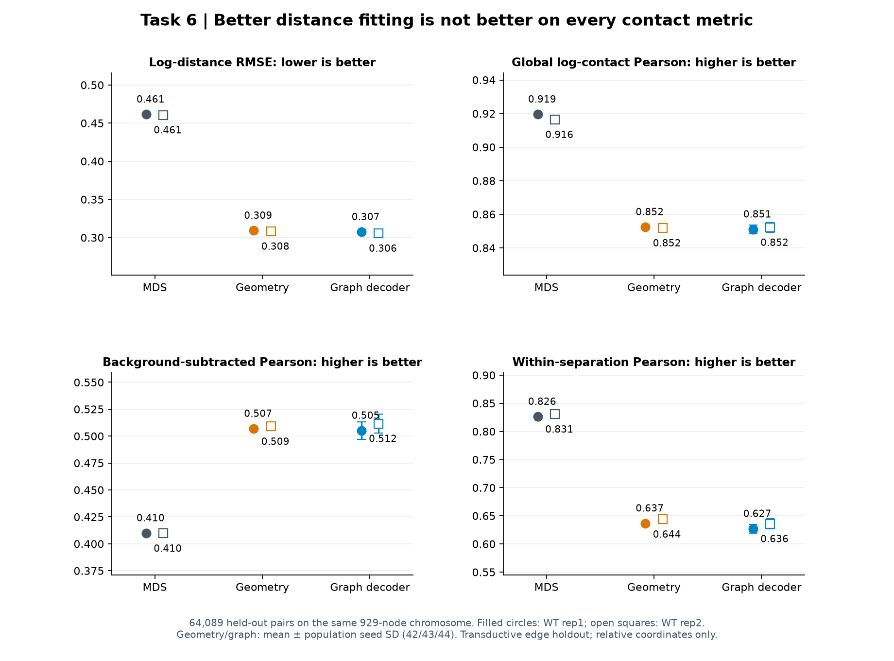
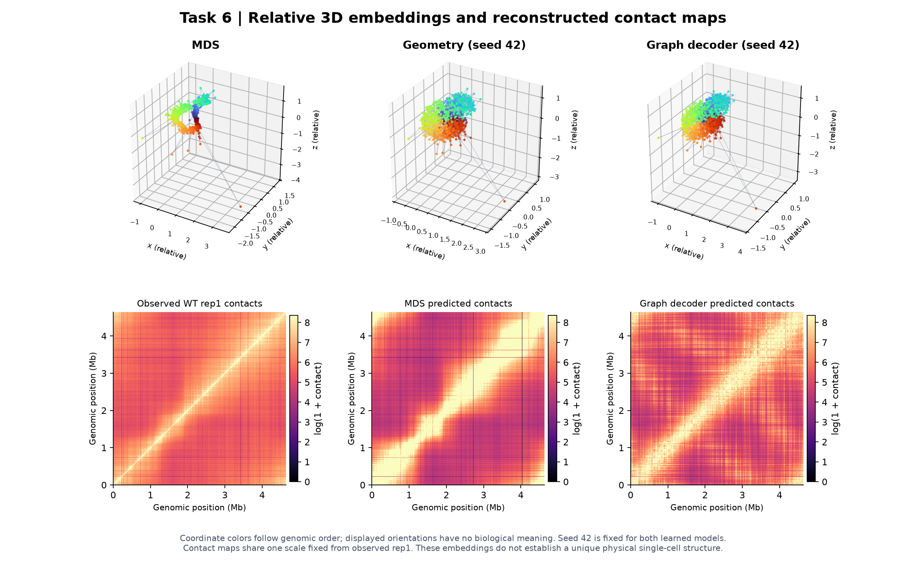

# 任务六：接触约束下的相对三维嵌入

[返回项目概览](../README.md) · 本文件统一维护任务六的问题、方法、结果、图表及运行说明。更新日期：2026-10-15。

**交付结论：完成5 kb、929节点的相对三维嵌入、三方法比较、留出边评价及种子稳定性分析。Graph降低接触推导距离的拟合误差，但若干接触相关指标低于MDS；没有验证真实单细胞构象、物理距离或宏观域恢复。** 本次整理及复算未新增优化，六份历史学习模型权重仍缺失。

## 1. 问题定义与数据

将群体Micro-C接触强度转化为假设距离约束，为染色体各bin赋予相对三维坐标，再检查留出接触边是否能被这些坐标解释。这个问题通常不唯一：相同群体接触统计可以对应不同构象，坐标整体旋转、平移和镜像也不改变两两距离。

| 项目 | 实际设置 |
| --- | --- |
| 染色体与分辨率 | `NC_000913.3`，4,641,652 bp，5 kb聚合，929节点 |
| 数据分工 | WT rep1拟合与选模；WT rep2仅评价，不参与坐标拟合 |
| 端点划分 | 非相邻上三角边，固定pair split seed2026 |
| 边数 | train 301,766；validation 64,272；test 64,089 |
| 方法与规模 | MDS；Geometry三seed；Graph decoder三seed；共7组坐标、6次学习优化 |
| 评价规模 | 7方法/seed端点×2WT×3边分区＝42行 |

全部分区共享同一染色体节点，是**传导式留出边评价**，不是未见染色体、独立细胞或独立基因组泛化。数十万条边和三个优化seed不能累加为独立生物学样本量。末端bin仅1,652 bp，做了有效长度校正；环距索引仍有离散近似。

## 2. 模型、对照与实现

接触转距离采用`d ∝ (contact + 0.5)^(-1/3)`，再用训练边距离中位数定标。幂律指数、伪计数及环形链连接均为建模假设，坐标没有校准后的物理单位。距离背景、缺失边填补、MDS初始化和图邻接只来自训练边；rep2做文库深度对齐后评价。

| 方法 | 设计与比较作用 |
| --- | --- |
| MDS | 训练边距离及训练距离背景构造完整距离矩阵，经典MDS取三维；全局距离尺度也仅由训练边校正，作为非神经基线 |
| Geometry | 直接优化929×3坐标，从MDS加微小噪声初始化；检验距离目标本身的增量 |
| Graph decoder | MDS初始坐标、基因组位置的正余弦特征及可学习节点嵌入，经图聚合预测三维位移；隐藏维32，以初始坐标加位移输出 |

Geometry与Graph各seed42/43/44，使用相同边划分、距离目标与初始化来源。训练为Adam、学习率0.01、最多500轮、patience50，损失为训练边log距离均方误差加环形相邻节点弹簧正则，后者权重0.02。只由验证边距离损失选轮次，测试边不参与选模。

除log距离RMSE，还评价反算接触的log-Pearson、Spearman、扣除训练距离背景后的Pearson，以及同一基因组距离分层内的加权Pearson。后两项有助于判断相关是否主要来自“基因组上越近、接触越多”的背景规律。模型设置见[optional_tasks.json](../configs/shared/optional_tasks.json)，实现见[train_task6.py](../scripts/task6/train_task6.py)。

## 3. 多指标结果与图表分析

下表为rep1测试边；Geometry、Graph是三seed均值，MDS无优化seed。↑越高越好，↓越低越好。

| 方法 | log距离RMSE↓ | log接触Pearson↑ | 接触Spearman↑ | 背景扣除Pearson↑ | 同距离分层Pearson↑ |
| --- | ---: | ---: | ---: | ---: | ---: |
| MDS | 0.461426 | **0.919491** | **0.940466** | 0.409917 | **0.826162** |
| Geometry | 0.309125 | 0.852392 | 0.863164 | **0.506845** | 0.636571 |
| Graph decoder | **0.307278** | 0.851026 | 0.843445 | 0.505080 | 0.626914 |



**图1分析。** Graph相对MDS降低约**33.41%**的log距离RMSE，也改善背景扣除后的相关；但全局接触Pearson、Spearman和同距离分层相关低于MDS。Graph相对Geometry的RMSE增益较小，不能声称图模型全面优胜。rep2中Graph/MDS的log距离RMSE为**0.305556/0.460685**，接触Pearson为**0.852155/0.916418**，同样存在这种取舍。图中学习方法误差条是三个seed的总体标准差，`ddof=0`，不是生物学置信区间。

从保存坐标重算两两seed的节点距离相关，Geometry为**0.993209–0.994751**，Graph为**0.981089–0.987444**。两两距离对整体旋转、平移和镜像不敏感，因此适合衡量重复优化的一致性；高相关只说明固定节点、划分和初始化规则下相对距离稳定，不能证明恢复真实物理构象。



**图2分析。** MDS基线与固定seed42的Geometry、Graph并列，颜色表示基因组位置；MDS本身没有优化seed。坐标的朝向、旋转和整体尺度不具有校准后的物理意义，视觉上的环状、聚团或分区不能直接认定为细胞内真实结构域。接触图按共同显示规则比较，用来同时检查拟合收益与残留差异。

历史交互图中的宏观域颜色是文献启发的示意，未用于坐标拟合；四域回转半径诊断也未支持所有域都更紧致。不能将预先赋予的颜色当成模型自动发现宏观结构域的证据。[交互三维浏览](../showcase/results/task6/index.html)可旋转与缩放，适合检查相对几何，不提供新的生物验证。

## 4. 完成状态、证据与限制

| 交付项 | 状态与依据 |
| --- | --- |
| 三方法、相对坐标与可视化 | 已完成MDS、Geometry、Graph及七组保存坐标/反算矩阵 |
| 留出边与跨WT评价 | 已完成42行，多指标同时报告，有利与不利结果均保留 |
| 保存结果复算 | 由七组坐标与矩阵重算42行指标，最大误差约8.81×10⁻⁹；原5 kb缓存计数守恒核对通过 |
| 种子稳定性 | 已完成两学习方法的六对seed距离相关；这是优化稳定性分析 |
| 历史模型直接推理 | 六份学习权重缺失；保存坐标可核验，不能声称原权重已经恢复 |
| 真实三维构象/宏观域 | 未验证；没有独立成像、物理尺度或真实单细胞坐标支持 |

主要证据及复核入口：

- [可机读全指标、种子稳定性与来源](../submission/task56_delivery_summary.json)。
- [历史指标CSV](../showcase/results/task6/metrics.csv)、[graph seed42坐标](../showcase/results/task6/graph_42_coordinates.csv)、[宏观域几何诊断](../showcase/results/task6/domain_geometry.csv)、[三维交互入口](../showcase/results/task6/index.html)。
- 完整本地复算记录：`reports/shared/tasks56/review_v2/review.json`、`task6_recomputed_metrics.csv`；公开的可机读复算结论见上方交付汇总。
- [保存结果复算实现](../scripts/shared/tasks56/review_saved_task56.py)、[本文件图表的生成实现](../scripts/shared/tasks56/build_task56_delivery.py)。完整历史数组及其评价输入保存在`results/task6/reconstruction/v1/`，只读保留。

后续应先保留完整新权重、坐标和评价来源，按预先固定规则检查幂律/链正则假设与多指标取舍。如要论证真实构象，需要独立空间证据及物理尺度校准；进一步压低当前留出边误差、增加seed或改进三维外观都不能替代这些证据。

## 5. 如何运行与验收

环境安装、轻量检查与项目目录见[README](../README.md)。以下在克隆后的项目根目录、Conda `microcture`中执行。**完整优化和原始矩阵扫描由用户运行，本次文档整理未启动。** 指定尚不存在的新版本输出目录，禁止覆盖历史坐标或封存结果。

已有5 kb缓存时直接运行：

```bash
conda run --no-capture-output -n microcture python -B run.py task6 \
  --data-root . --output-dir results/task6/reconstruction/next_v1
```

默认读取`data/task6/cache/contact_5kb/WT_37C_rep1.npz`与`WT_37C_rep2.npz`。如果确实缺少缓存，先显式扫描原始矩阵，再传给训练；已有缓存时无需重复扫描：

```bash
conda run --no-capture-output -n microcture python -B run.py prepare-task6 \
  --data-root . --output-dir data/task6/cache/next_v1
conda run --no-capture-output -n microcture python -B run.py task6 \
  --data-root . --cache-dir data/task6/cache/next_v1 \
  --output-dir results/task6/reconstruction/next_v2
```

5 kb缓存为两份929×929矩阵，每份float64约6.9 MB；扫描时另有HDF5块与上三角累加。MDS和六次优化使用CPU、4线程、最多500轮，需要为邻接、距离矩阵、梯度与图表另留内存。当前完整重跑未重新计时，原始扫描尤其取决于WSL磁盘；不要把缓存大小或500轮上限直接当作实测耗时。

若只核验已有保存结果，不训练、不恢复权重：

```bash
conda run --no-capture-output -n microcture python -B run.py review-task56 review \
  --data-root . --report-dir reports/shared/tasks56/review_next_v1
```

它同时复核[任务五](TASK5.md)，完整本地历史数组可用时应重算42行三维指标及848行超分辨指标。精简GitHub展示仓库仅核验随包快照时使用`run.py check --skip-tests`，缺失原始数组时不能宣称已重建全部历史数值。

完整新运行成功需同时满足：

1. `manifest.json`记录929节点、配置、训练拟合参数、输入SHA与301,766/64,272/64,089边划分；`evaluation_inputs.npz`保存评价输入。
2. 七组`*_coordinates.csv`与`*_maps.npz`、六份学习模型权重与history、`training_summary.csv`均保留，`metrics.csv`恰42行。
3. `seed_stability.csv`、`domain_geometry.csv`、接触对照图和三维`index.html`齐全；同时分析距离与接触指标，不以单一误差或三维外观验收。

需要继续分析时回传新目录及`manifest.json`、`training_summary.csv`、`metrics.csv`、`seed_stability.csv`、`domain_geometry.csv`、history与异常终端日志；不同seed和不利端点都需保留。
